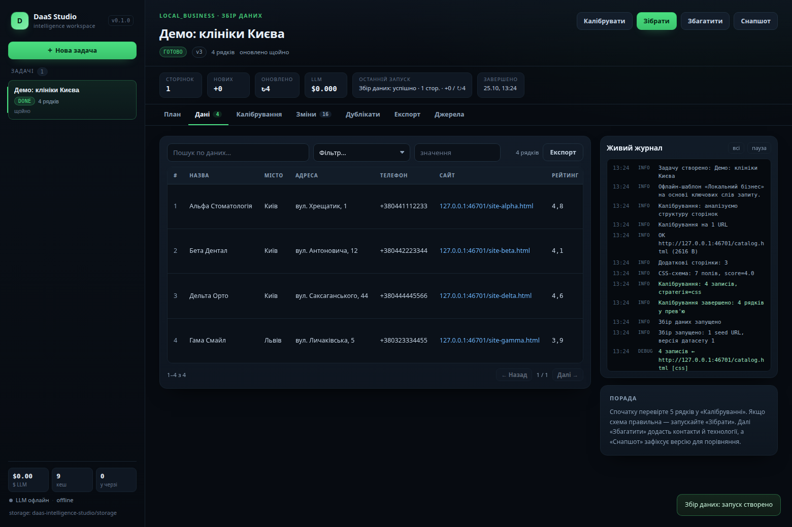
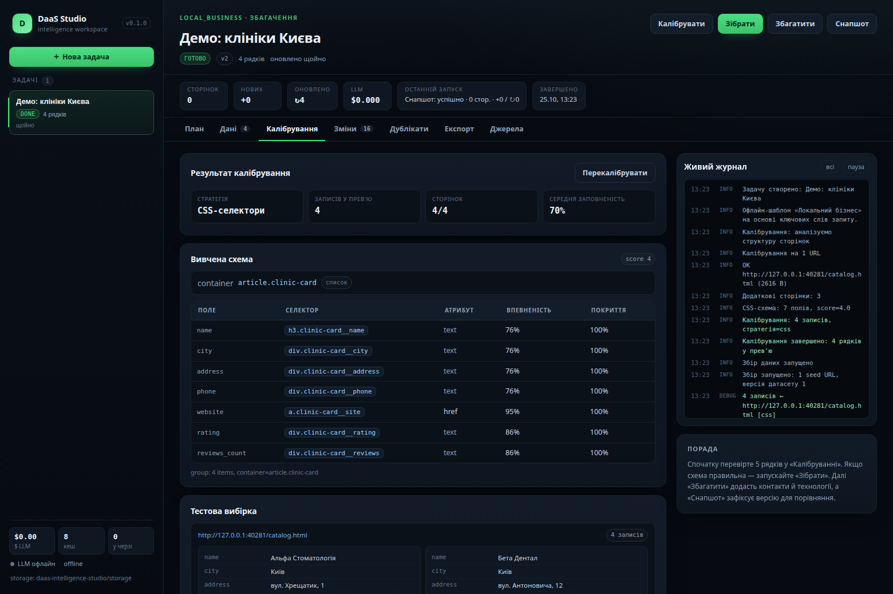
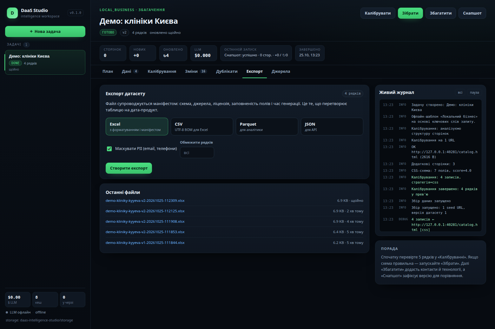
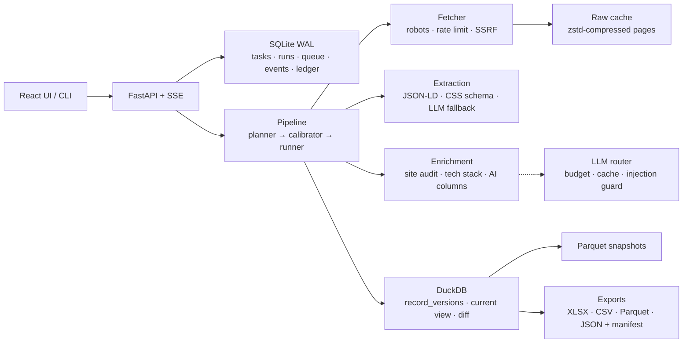

# DaaS Intelligence Studio

> Локальна AI-студія, яка перетворює бізнес-питання на **готовий дата-продукт**:
> промпт → схема → калібрування парсера → збір → збагачення → історія змін → експорт із маніфестом.



Не ще один «скрейпер». Гроші в DaaS — не в сирих рядках, а в **дедуплікації, збагаченні
(контакти, технології, сигнали наміру) та історії**, яку конкурент не спарсить заднім числом.
Студія будує саме це — локально, з контролем витрат на LLM і без залежності від хмари.

---

## Швидкий старт

Потрібні Python 3.11–3.13, [uv](https://docs.astral.sh/uv/), Node 20+ (для UI).

```bash
git clone <repo> && cd daas-intelligence-studio

# 1) UI (один раз; React + Vite)
cd frontend && npm install && npm run build

# 2) Backend + демо
cd ../backend
uv sync --extra dev
uv run daas demo --serve          # офлайн-демо + студія на http://127.0.0.1:8000
```

Або скорочено: `make setup && make demo`.

Без зібраного UI `daas serve` покаже сторінку-підказку, а API працюватиме. Для розробки UI:
`cd frontend && npm run dev` (http://localhost:5173, проксі на `127.0.0.1:8000`).

`daas demo --serve`:

1. генерує локальний сайт-каталог клінік (без мережі);
2. проганяє весь пайплайн: калібрування → збір → збагачення → снапшот → XLSX;
3. залишає **живе джерело** та відкриває студію — кнопки «Зібрати», «Збагатити», «Снапшот»
   працюють по-справжньому.

Відкрийте [http://127.0.0.1:8000](http://127.0.0.1:8000). Токен доступу — у
`storage/runtime.json` (вбудований у сторінку під час віддачі; для Vite dev-сервера
підхоплюється з файлу).

### Власні джерела

1. **UI:** «Нова задача» → промпт + 1-3 стартові URL → перевірте колонки → **Калібрувати** →
   перегляньте прев'ю → **Зібрати** → **Збагатити** → **Снапшот** → **Експорт**.
2. **CLI:**

```bash
uv run daas task create --prompt "Стоматологічні клініки Києва: рейтинг, контакти, сайт" \
  --seed https://example.com/clinics

uv run daas calibrate <task_id>       # тестова вибірка → CSS-схема
uv run daas collect <task_id> --pages 200
uv run daas enrich <task_id>
uv run daas snapshot <task_id>
uv run daas export <task_id> --format xlsx
```

---

## Що вже працює (v0.1)

- **План задачі** з промпту: LLM (якщо налаштований) або офлайн-шаблони для локального бізнесу,
  компаній, нерухомості, e-commerce, вакансій і тендерів. Колонки мають тип, PII-мітку та метод.
- **Двофазний парсинг:** калібрування на 2-4 сторінках (евристичний CSS-learner, без LLM) →
  масовий детермінований збір. LLM — лише fallback, з бюджетом, кешем і захистом від injection.
- **JSON-LD / schema.org** як найточніша стратегія (Product, Organization, LocalBusiness, JobPosting…).
- **Стійка черга на SQLite:** lease, heartbeat, retry-таксономія (`transient / blocked / permanent`),
  відновлення після краху, скасування.
- **Waterfall-збагачення:** аудит сайту (email, телефони, соцмережі), детекція технологій, ознаки
  онлайн-запису/чату, пошук офіційного сайту через SearXNG, AI-колонки з промптом.
- **Історія:** append-only версії записів, `current_records`, Parquet-снапшоти, детекція змін
  (`new_entity`, `field_changed`, `price_drop`) і живий журнал подій через SSE.
- **Експорт:** XLSX (форматування + аркуш маніфесту), CSV (UTF-8 BOM), Parquet, JSON — з ліцензією,
  походженням і маскуванням PII. **Персональні дані маскуються завжди.**
- **Локальний API + UI:** React/Vite, таблиця з серверними фільтрами/сортуванням/пагінацією,
  калібрування, зміни, дублікати, реєстр джерел, живі логи.
- **Безпека:** Bearer-токен + Host-guard (DNS-rebinding), CSP, SSRF-захист, robots.txt, rate limit.
- **Офлайн-режим:** демо та тести не звертаються до мережі.




---

## LLM: локально або хмара

Будь-який OpenAI-сумісний endpoint. За замовчуванням пробується локальний Ollama, потім хмара, якщо
вона налаштована; локальні моделі для масових задач — дешевше й приватніше.

```bash
cd backend
cp ../.env.example ../.env
```

```dotenv
# Локально (Ollama): ReaderLM-v2 / Qwen2.5 для екстракції
DAAS_LLM_LOCAL_BASE_URL=http://127.0.0.1:11434/v1
DAAS_LLM_LOCAL_MODEL=readerlm-v2

# Хмара (опційно) для планування та складних випадків
# DAAS_LLM_BASE_URL=https://api.openai.com/v1
# DAAS_LLM_API_KEY=sk-...
# DAAS_LLM_MODEL=gpt-4o-mini
# DAAS_LLM_BUDGET_USD=0.75
```

Без LLM студія працює повністю: шаблони схем, JSON-LD, CSS-калібрування, збагачення контактів.
AI-колонки та LLM-fallback просто вимикаються.

Опційна інфраструктура: `docker compose up -d` (Ollama + SearXNG). Для SearXNG потрібен JSON-формат —
конфіг лежить у `docker/searxng/settings.yml`.

---

## Архітектура



- **DuckDB** — append-only `record_versions`, вью `current_records`, дельта між версіями.
- **SQLite (WAL)** — операційний стан: черга URL із lease, запуски, події, витрати LLM, схеми селекторів.
- **Raw cache (zstd)** — сирі сторінки; нове поле через місяць = локальна пере-екстракція, а не новий краул.
- **Один writer у DuckDB** (in-process lock). Для масштабу — воркер окремим процесом (roadmap).

Деталі та ADR: [`docs/02_CONCEPT_REVIEW_AND_IMPROVEMENTS.md`](docs/02_CONCEPT_REVIEW_AND_IMPROVEMENTS.md).

---

## API (стисло)

| Метод | Шлях | Призначення |
|:---|:---|:---|
| `POST` | `/api/tasks` | промпт + seed URL → план і схема |
| `POST` | `/api/tasks/{id}/calibrate` | калібрування на тестовій вибірці |
| `POST` | `/api/tasks/{id}/run` | масовий збір (після калібрування) |
| `POST` | `/api/tasks/{id}/enrich` | збагачення / AI-колонки |
| `POST` | `/api/tasks/{id}/snapshot` | Parquet + детекція змін |
| `GET` | `/api/tasks/{id}/records` | фільтри, сортування, пагінація |
| `GET` | `/api/tasks/{id}/changes` | виявлені зміни |
| `POST` | `/api/tasks/{id}/exports` | створити файл + маніфест |
| `GET` | `/api/tasks/{id}/events/stream` | SSE-журнал |
| `PUT` | `/api/sources/{domain}` | ToS-ризик, ліцензія, нотатки |
| `POST` | `/api/maintenance/backup` | бекап сховища (SQLite + DuckDB + снапшоти) |

Повна схема: `/api/docs` (Swagger) після запуску.

---

## Тести та якість

```bash
cd backend
uv run pytest -q            # 55 тестів, без мережі
uv run ruff check app tests

cd ../frontend
npm run build               # tsc + vite
```

Тести побудовані на локальних HTML-фікстурах (`backend/tests/fixtures/`) і `FixtureFetcher`:
калібрування, JSON-LD, екстракція, черга, версії/diff, експорти, бюджет LLM, SSRF/PII,
повний API-флоу з маскуванням.

---

## Безпека та комплаєнс

- Локальний API слухає `127.0.0.1`, захищений токеном; сторонні `Host` відхиляються.
- **robots.txt поважається** (404 → дозволено, 5xx → заборонено), `Crawl-delay` враховується.
- Реєстр джерел: `tos_risk`, ліцензія, нотатки, дата перевірки.
- PII: класифікація на рівні колонки, маскування в семплах, редагування перед cloud-LLM,
  заборона експорту персональних даних у відкритому вигляді.
- SSRF-захист: приватні/loopback адреси та DNS-відповіді перевіряються до запиту.
- **Ніякого виконання LLM-коду:** тільки декларативні CSS-селектори.
- Prompt injection: вміст сторінки — недовірені дані, без tools, валідація за схемою, cross-check.

Це інженерні запобіжники, **не юридична консультація**. Перед продажем даних перевірте ToS джерел і
місцеве законодавство (GDPR/CCPA та ін.).

---

## Обмеження v0.1

Детально — у [`docs/03_IMPLEMENTATION_PLAN.md`](docs/03_IMPLEMENTATION_PLAN.md#7-відомі-обмеження-v01-чесно).
Коротко: немає tombstones для видалених записів, gold-set метрик точності, merge/unmerge дублікатів,
планувальника, проксі-пулу та важких рушіїв (Playwright/Camoufox) — це наступні етапи.

Одна студія на сховище: запущений `daas serve` тримає DuckDB, тому CLI-команди, що пишуть,
слід запускати після його зупинки; бекап під час роботи — через `POST /api/maintenance/backup`.

---

## Документація

| Документ | Про що |
|:---|:---|
| [01. Концепція та архітектура](docs/01_CONCEPT_AND_ARCHITECTURE.md) | початкова ідея, стек, UX |
| [02. Огляд і покращення](docs/02_CONCEPT_REVIEW_AND_IMPROVEMENTS.md) | критичний розбір, фактчек, P0-ризики, ADR |
| [03. План і статус](docs/03_IMPLEMENTATION_PLAN.md) | що зроблено, беклог, критерії приймання, обмеження |

---

## Roadmap

- **P1:** eval-харнес (precision/recall), merge/unmerge дублікатів, tombstones + full-crawl diff,
  планувальник і ноутіфікації, комплаєнс-енфорсмент, проксі-провайдери, карантин у UI.
- **P2:** discovery (sitemap/OSM/Open Data), JS-рендеринг сайдкаром, FTS/семантика, Splink batch ER.
- **P3:** окремий Data API з ключами й метерингом, клієнтський портал, білінг, маркетплейс дата-продуктів.
