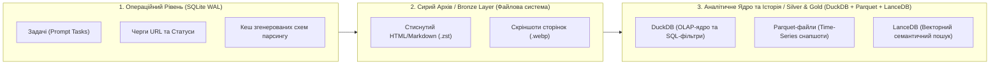
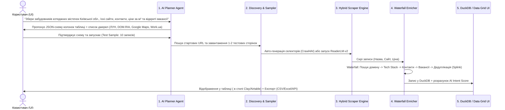

# Концепція та Архітектура Платформи: AI-Powered DaaS Studio (`daas-intelligence-studio`)

> [!NOTE]
> **Статус (v0.1):** концепцію реалізовано вертикальним зрізом — план → калібрування →
> збір → збагачення → снапшот → експорт → UI. Критичний розбір і покращення:
> [`02_CONCEPT_REVIEW_AND_IMPROVEMENTS.md`](./02_CONCEPT_REVIEW_AND_IMPROVEMENTS.md);
> план, статус і відомі обмеження: [`03_IMPLEMENTATION_PLAN.md`](./03_IMPLEMENTATION_PLAN.md).
> Частину технічних тверджень нижче уточнено у розділі «Фактчек» документа 02.

> [!IMPORTANT]
> **Головна бізнес-ідея (на основі дослідження ринку DaaS):**
> Сирі спарсені дані коштують дешево. Бізнес платить високі чеки ($49–$499+/міс) за **відповіді на бізнес-питання**: агрегацію з різних джерел, дедуплікацію, **збагачення (Data Enrichment)**, виявлення сигналів наміру (**Intent Data**) та **історичність (Time-series динаміку)** — те, що конкурент не зможе спарсити «заднім числом».

---

## 1. Дослідження екосистеми: Бібліотеки та Моделі Інтелектуального Парсингу (2025–2026)

Сучасний стек парсингу відійшов від крихких CSS/XPath-селекторів, які ламаються при кожному оновленні дизайну сайту. Нижче наведено повний стек бібліотек та спеціалізованих моделей, розділений за рівнями задач.

### 1.1. AI-Native бібліотеки та фреймворки парсингу (Python)

| Бібліотека / Інструмент | Категорія | Як працює та в чому сила | Коли використовувати у нашому продукті |
| :--- | :--- | :--- | :--- |
| **[Crawl4AI](https://github.com/unclecode/crawl4ai)** | Швидкісний LLM-ready краулер | Працює поверх Playwright, автоматично очищує DOM від реклами/меню/шуму, перетворює сторінку в чистий Markdown або JSON. Підтримує гібридний підхід: **LLM-генерація CSS/XPath схеми один раз** (`JsonCssExtractionStrategy`) і далі безкоштовний парсинг тисяч сторінок без виклику LLM. | **Основний робочий двигун (80% задач):** парсинг каталогів, карток товарів, профілів компаній, новин, вакансій. |
| **[Scrapling](https://github.com/D4Vinci/Scrapling) + [Camoufox](https://github.com/daijro/camoufox)** | Stealth-фреймворк + Антидетект браузер | **Camoufox** — кастомний Firefox, пропатчений на рівні C++ двигуна (підміна Canvas, WebGL, шрифтів, TLS/JA3-фінгерпринтів), який обходить Cloudflare Turnstile та DataDome. **Scrapling** додає адаптивні селектори (`auto_match=True`), які самі знаходять елемент, якщо верстка змінилася. | **Складні донори з антибот-захистом:** маркетплейси, захищені бізнес-каталоги, сайти нерухомості за Cloudflare. |
| **[Browser-Use](https://github.com/browser-use/browser-use)** | Автономний мультимодальний Web-Агент | Перетворює LLM (з Vision) на оператора браузера, який сам клікає кнопки, заповнює форми пошуку, гортає фільтри, проходить пагінацію та авторизацію. | **Динамічний ресерч та складні сценарії:** коли потрібно зайти на портал, ввести запит у складну форму, виставити фільтри й зібрати результати. |
| **[ScrapeGraphAI](https://github.com/ScrapeGraphAI/ScrapeGraphAI)** | Графовий Промпт-парсер | Будує пайплайн у вигляді графа (`SmartScraperGraph`, `SearchGraph`), де достатньо подати URL та промпт + Pydantic-схему. | **Швидке прототипування та мульти-сторінковий пошук у вебі** (`SearchGraph` для збору інформації про компанію з різних сайтів). |
| **[Skyvern](https://github.com/Skyvern-AI/skyvern)** | Vision + LLM автоматизація воркфлоу | Не покладається на DOM-селектори взагалі — дивиться на сторінку комп'ютерним зором (CV + LLM), стійкий до будь-яких змін інтерфейсу. | Державні реєстри, митні бази, застарілі або надскладні корпоративні портали. |

---

### 1.2. Спеціалізовані локальні моделі (SLM) для парсингу HTML -> JSON / Markdown

Використовувати платні API великих моделей (GPT-4o, Claude 3.5, Gemini Pro) на кожній із 100 000 сторінок — економічно невигідно. Натомість індустрія використовує **спеціалізовані малі моделі (Small Language Models)**, навчені спеціально на перетворенні брудного HTML у чистий JSON за заданою JSON-схемою (працюють локально через **Ollama**, **vLLM** або **llama.cpp**):

1. **`jinaai/ReaderLM-v2` (1.5B параметрів, контекст до 512K токенів)** — *Золотий стандарт локального парсингу*:
   - Створена Jina AI на базі Qwen2.5-1.5B спеціально для двох задач: **HTML-to-Markdown** та **HTML-to-JSON (пряма екстракція за JSON Schema)**.
   - Завдяки величезному контексту (512K) вміщує цілий DOM сторінки без чанкінгу і на виході видає валідний JSON, перевершуючи значно більші моделі.
   - Споживає мінімум VRAM (~3–4 ГБ), тому літає локально на звичайній відеокарті або CPU.
2. **`Qwen2.5-Coder-7B-Instruct` / `Qwen3-8B` (з Outlines / Structured Outputs)**:
   - Ідеальна локальна модель для **генерації селекторів** (коли модель дивиться на 1 сторінку каталогу і пише Python/CSS-правила для парсингу решти 50 000 сторінок) та для очищення/нормалізації тексту.
3. **`NuExtract-v1.5` (від NuMind, 3.8B / 7B)**:
   - Спеціалізована модель для екстракції сутностей та структурованих полів із неструктурованого тексту (описи вакансій, тендери, судові рішення, відгуки).
4. **Хмарні LLM (Gemini 2.5 Flash / Gemini Pro, GPT-4o-mini) у режимі каскаду**:
   - Використовуються тільки для **оркестрації (планування задачі)**, складних випадків (fallback) та інтелектуального скорингу лідів.

---

### 1.3. Інструменти для Збагачення Даних (Data Enrichment & Entity Resolution)

Щоб перетворити сирий рядок на дорогий бізнес-лід (аналог платформи **Clay**, але локально й без переплат за кредити):

* **Пошук технологічного стеку сайту (Tech Stack Detection):** `Wappalyzer` (open-source правила) / `webtech` — миттєво визначає, яку CMS, CRM (HubSpot, Salesforce), платіжку (Stripe) чи пікселі використовує компанія.
* **Контакти, соцмережі та Email-пошук:** парсинг сторінок `/contact`, `/about`, витягування профілів LinkedIn/Instagram/Telegram, генерація корпоративних email-патернів + перевірка існування пошти через SMTP/DNS (`py3-validate-email`, `dnspython` MX-записи).
* **Державні реєстри та Open Data API:** інтеграція з українськими та світовими відкритими реєстрами (ЄДР / Prozorro API / OpenCorporates / SEC EDGAR / Google Places API).
* **Дедуплікація та Entity Resolution (зведення записів з різних сайтів в один):**
  - **[Splink](https://github.com/moj-analytical-services/splink)** (працює напряму поверх **DuckDB**!) або **[Dedupe](https://github.com/dedupeio/dedupe)** + `RapidFuzz`. Дозволяє автоматично зрозуміти, що *"ТОВ Альфа-Буд"*, *"AlphaBud LLC"* на LinkedIn і оголошення з тим самим телефоном на OLX — це одна й та сама компанія.

---

## 2. Як найкраще зберігати інформацію локально? (Local-First Storage Architecture)

Для DaaS-проекту звичайна одна база даних не підходить: потрібно одночасно керувати станом задач у реальному часі, зберігати сирі скрапи і робити миттєву аналітику/фільтрацію по мільйонах рядків з історією змін (Time-Series).

Найкраща архітектура локального збереження — **Трирівневе Гібридне Сховище (Hybrid Local Data Lakehouse)**:



### Чому саме ця комбінація є ідеальною локально:

1. **DuckDB + Apache Parquet (Основа для даних та історичності):**
   - **DuckDB** — це вбудована колоночна (OLAP) база даних (як SQLite, не потребує окремого сервера, зберігається у файлі `.duckdb`), але здатна фільтрувати та агрегувати **10–100 мільйонів рядків за мілісекунди** на звичайному ноутбуці.
   - Нативно підтримує `JSON`-колонки (ідеально, коли у різних джерел різні додаткові поля) та повнотекстовий пошук (FTS).
   - **Збереження історії (Time-Series):** Щоденні зрізи (ціни конкурентів, кількість вакансій, статус наявності) зберігаються у партиціонованих файлах `data/snapshots/dataset=ecommerce/date=2026-10-21/part.parquet`. DuckDB робить SQL-запити прямо по папці з Parquet-файлами і миттєво рахує дельту: *"Покажи товари, де ціна впала на >15% за останні 7 днів"*.
   - Миттєвий експорт на продаж одним рядком SQL: `COPY (SELECT ...) TO 'export.csv' (HEADER)` або у `.xlsx` / `.parquet` / `.json`.
2. **SQLite (у режимі WAL) — для оркестрації додатку:**
   - Відповідає за чати з користувачем, розклад запусків (cron), логи воркерів, проксі-пули та стан кожної URL-адреси в черзі (щоб при обриві парсинг продовжувався з місця зупинки).
3. **LanceDB — локальна файлова векторна база:**
   - Не потребує Docker-контейнера (на відміну від Qdrant/Milvus). Дозволяє робити **семантичні фільтри по бізнес-даних**, наприклад: *"Знайди серед 50 000 спарсених компаній ті, чий опис діяльності схожий на виїзний кейтеринг для корпоративів"*.
4. **Стиснутий Raw Cache (`.zst` — Zstandard):**
   - Сирий очищений Markdown/HTML кожної спарсеної сторінки зберігається локально зі стисненням Zstandard (стискає текст у 5–8 разів). Якщо через місяць клієнт попросить витягнути нове поле (наприклад, код ЄДРПОУ або гарантійний термін), **вам не потрібно перепарсювати сайт і витрачати проксі** — локальна модель `ReaderLM-v2` перечитає локальний кеш!

---

## 3. Концепція Приложіння: Як працює система від Промпту до Продажу Даних

Користувач відкриває локальний Web UI, пише задачу природною мовою, і система бере на себе весь цикл:

### Життєвий цикл задачі (5 етапів пайплайну):



### Детальний розбір фіч застосунку:

#### Модуль 1: Інтелектуальна Постановка Задачі (Task Studio)
* Ви пишете промпт: *"Знайди всі стоматологічні клініки у Львові та Києві з рейтингом нижче 4.2 на Google Maps, витягни їхні сайти, перевір чи є у них онлайн-запис та знайди контакти керівників"*.
* **AI Architect Agent** аналізує запит і автоматично розбиває його на:
  1. **Цільову схему таблиці (Pydantic / JSON Schema):** `company_name`, `city`, `gmaps_rating`, `reviews_count`, `website`, `has_online_booking` (boolean), `crm_widget` (string), `decision_maker_contacts` (JSON), `pain_score` (1-100).
  2. **Джерела збору (Seed Sources):** де шукати первинний список.
  3. **Кроки збагачення (Enrichment Columns):** які додаткові парсери запустити для кожного знайденого рядка.

#### Модуль 2: Двофазний Економічний Парсинг (Smart Cost-Saving Scraping)
Щоб не спалювати гроші на токенах LLM:
* **Фаза А (Калібрування на 3 сторінках):** Агент відкриває перші 2–3 сторінки сайту-донора через `Crawl4AI` / `Camoufox`. LLM аналізує структуру DOM і **генерує детерміновану схему екстракції** (CSS/XPath селектори або правила для `Scrapling`). Користувач бачить прев'ю 5 рядків у UI і тисне **"Затвердити та запустити на всі 10 000 сторінок"**.
* **Фаза Б (Масовий парсинг + Self-Healing):** Парсер біжить на максимальній швидкості без викликів платних LLM. Якщо на якійсь сторінці структура нестандартна або сайт оновив верстку — автоматично вмикається локальна модель `ReaderLM-v2` (або `Scrapling auto_match`), витягує дані й оновлює селектор.

#### Модуль 3: Конвеєр Збагачення (Waterfall Enrichment — "Локальний Clay")
У таблиці даних кожна нова колонка може бути **віртуальним агентом збагачення**:
1. **Domain Resolver:** Є тільки назва компанії чи Instagram? Агент робить пошуковий запит і знаходить офіційний сайт.
2. **Website Deep Crawl:** Заходить на знайдений сайт, сканує головну сторінку, `/about`, `/contacts`, визначає мобільну адаптивність, наявність чатів/CRM, парсить email-адреси та лінки на соцмережі.
3. **Job & Intent Signals:** Перевіряє, чи шукає ця компанія зараз співробітників (наприклад, РОПа, маркетолога чи таргетолога) — це прямий сигнал для B2B-продажів, що у компанії є бюджет і біль.
4. **AI Custom Column (Промпт-колонка):** Можливість додати колонку з власним промптом для кожного рядка, наприклад: *"Прочитай останні 10 негативних відгуків цієї клініки і випиши одним реченням головну скаргу клієнтів"*.

#### Модуль 4: Історичний Моніторинг (Time-Series & Change Detection)
* Будь-яку задачу можна перевести в режим **Scheduled (за розкладом: щодня / щотижня)**.
* Система автоматично порівнює новий зріз у DuckDB з попереднім і генерує **Тригери (Events)**:
  - `PRICE_DROP` (ціна знизилась на X%)
  - `NEW_COMPETITOR_PRODUCT` (з'явився новий товар/оголошення)
  - `NEW_JOB_POSTED` (компанія відкрила ключову вакансію)
  - `OUT_OF_STOCK` (товар закінчився у конкурента)

---

## 4. Концепція Інтерфейсу Користувача (UI/UX Design)

Інтерфейс поєднує простоту чату (як у ChatGPT/Claude) та потужність інтерактивної таблиці збагачення (як у Clay.com / Airtable):

1. **Command Center (Чат + Конструктор Пайплайнів):**
   - Поле вводу задачі природною мовою.
   - Візуальний граф пайплайну: `[Джерело 1: Каталог]` + `[Джерело 2: Карти]` ➔ `[Дедуплікація]` ➔ `[Збагачення: Сайт & Контакти]` ➔ `[AI Скоринг]`.
2. **Live Scraper Monitor (Живий термінал і Браузер):**
   - Відображення прогрес-бару, швидкості (сторінок/сек), статусу проксі, кількості пройдених антибот-перевірок та міні-вікно (Live View) того, що зараз бачить браузер-агент.
3. **Enrichment Data Grid (Інтерактивна Таблиця Даних):**
   - Таблиця на базі DuckDB з миттєвими фільтрами, сортуванням та кольоровими тегами.
   - Кнопка **`+ Додати AI-колонку збагачення`** прямо в шапці таблиці (натискаєте `+`, пишете що знайти для кожного рядка, і по таблиці пробігає воркер).
4. **Data Product Packager (Вітрина для продажу даних):**
   - Кнопка **"Створити клієнтський семпл"** — одним кліком генерує красивий демо-файл на 20 рядків (де частина контактів частково замаскована або відкрита для демонстрації якості) для холодного аутричу потенційним покупцям.
   - Повний експорт у **CSV, Excel (.xlsx з форматуванням), Parquet, JSON** або автоматичне підняття локального/хмарного **REST API ендпоінта** з API-ключами для клієнтів.

---

## 5. Пропонована структура проекту (`daas-intelligence-studio`)

```text
daas-intelligence-studio/
├── docs/
│   └── 01_CONCEPT_AND_ARCHITECTURE.md   # Цей концепт-документ
├── backend/
│   ├── app/
│   │   ├── api/                         # FastAPI ендпоінти для UI та клієнтського Data API
│   │   ├── agents/                      # Planner Agent, Schema Generator, Browser-Use Agent
│   │   ├── scrapers/                    # Обгортки Crawl4AI, Scrapling + Camoufox
│   │   ├── enrichment/                  # Waterfall-модулі (TechStack, Contacts, Deduplication)
│   │   ├── llm/                         # Клієнти для локальної Ollama (ReaderLM-v2) та Cloud API
│   │   └── storage/                     # Менеджери DuckDB, SQLite, Parquet та Zst Raw Cache
│   └── pyproject.toml
├── frontend/                            # Web UI (Next.js / React + TanStack Table або Streamlit/NiceGUI для швидкого MVP)
├── storage/                             # Локальне сховище даних (ігнорується в git)
│   ├── operational.sqlite               # Стан задач та черги
│   ├── analytics.duckdb                 # Головна аналітична база
│   ├── raw_cache/                       # Стиснуті .zst сторінки
│   ├── snapshots/                       # Історичні Parquet-файли
│   └── exports/                         # Готові датасети на продаж (.xlsx, .csv)
└── docker-compose.yml                   # Опціональний запуск Ollama, Redis/Celery
```

---

## 6. План реалізації (Roadmap від MVP до повноцінної платформи)

* **Етап 1 (Швидкий MVP — "Фабрика Датасетів"):**
  - Налаштування ядра: `FastAPI` + `Crawl4AI` + `Scrapling/Camoufox` + локальна `Ollama (ReaderLM-v2)` + `DuckDB`.
  - Створення UI, де можна ввести промпт/URL, затвердити схему на тестовій вибірці, спарсити базу, додати колонки збагачення і вивантажити готовий для продажу `.xlsx` / `.csv`.
* **Етап 2 (Waterfall Enrichment & Дедуплікація):**
  - Додавання автоматичних модулів збагачення (пошук сайту за назвою компанії, витягування тех-стеку, соцмереж, вакансій, об'єднання дублів через `Splink`).
* **Етап 3 (Історичність та Автоматизація моніторингу):**
  - Планувальник задач, збереження щоденних Parquet-снапшотів та автоматичний розрахунок змін (Time-Series тригери).
* **Етап 4 (Монетизація та Клієнтський Портал):**
  - Генератор клієнтських прев'ю-вітрин та API-ключів для продажу доступу за підпискою (Micro-SaaS).
