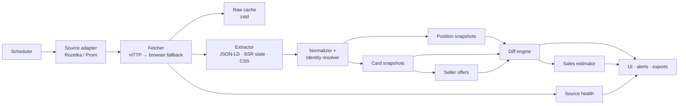

# Парсер маркетплейсів Rozetka та Prom.ua: концепція моніторингу позицій, карток і продажів

> [!NOTE]
> **Статус:** концепція v0.1 (для обговорення), 01.11.2026.
> **Обсяг:** Rozetka (`rozetka.com.ua`) і Prom.ua (`prom.ua`), Україна, щоденний моніторинг
> відібраних карток товару.
> **Пов'язані документи:** [`01_CONCEPT_AND_ARCHITECTURE.md`](./01_CONCEPT_AND_ARCHITECTURE.md),
> [`02_CONCEPT_REVIEW_AND_IMPROVEMENTS.md`](./02_CONCEPT_REVIEW_AND_IMPROVEMENTS.md),
> [`03_IMPLEMENTATION_PLAN.md`](./03_IMPLEMENTATION_PLAN.md).
> **Перевірка фактів:** твердження про розмітку, пагінацію, `robots.txt` і доступні поля звірені
> живими запитами 01.11.2026 (див. [Додаток E](#додаток-e-що-перевірено-живими-запитами)).

> [!IMPORTANT]
> **Короткий вердикт.** Парсер, який щодня показує зміну позицій, ціну, відгуки та кількість
> продавців, **розробити можливо** — для більшості категорій і більшості карток. Але три метрики
> з переліку мають принципові обмеження:
>
> 1. **Вподобайки** — публічного лічильника немає ні на Rozetka, ні на Prom. Цю метрику не можна
>    отримати легальним публічним парсингом; її треба або прибрати, або замінити проксі-сигналами.
> 2. **Кількість продажів через щоденну зміну залишку** — маркетплейси не показують кількість
>    одиниць на складі. На Prom є публічний лічильник «N+ купили», з якого можна рахувати дельту
>    (з округленням); на Rozetka прямого лічильника немає — можлива лише **оцінка** (індекс), а не
>    точні продажі.
> 3. **Кількість продавців на Rozetka** — блок «Всі продавці» підвантажується динамічно, тому це
>    «так, але дорожче і з неповним покриттям»; на Prom кількість продавців віддається одразу в
>    стані сторінки.
>
> **Щодо «обходу обмежень»:** частота оновлення парсера не є інструментом обходу антиботу. Стійка
> схема — це **низький і рівномірний бюджет запитів + офіційні/партнерські канали + браузерний
> fallback + моніторинг блокувань**, а не часта зміна коду. Детально — у [розділі 6](#6-частота-оновлення-та-робота-з-обмеженнями).

---

## Зміст

- [0. Резюме для керівництва](#0-резюме-для-керівництва)
- [1. Задача і межі](#1-задача-і-межі)
- [2. Терміни та метрики](#2-терміни-та-метрики)
- [3. Як влаштовані джерела](#3-як-влаштовані-джерела-фактична-розвідка)
- [4. Здійсненність кожної вимоги](#4-здійсненність-кожної-вимоги)
- [5. Архітектура рішення](#5-архітектура-рішення)
- [6. Частота оновлення та робота з обмеженнями](#6-частота-оновлення-та-робота-з-обмеженнями)
- [7. Якість даних](#7-якість-даних)
- [8. Комплаєнс і ризики](#8-комплаєнс-і-ризики)
- [9. MVP і план](#9-mvp-і-план)
- [10. Відкриті питання](#10-відкриті-питання)
- [Додатки A–F](#додаток-a-url-патерни-та-розміри-сторінок-перевірено-01112026)

---

## 0. Резюме для керівництва

### 0.1. Що замовив бізнес

Відібрати кілька карток товару на Rozetka та Prom.ua і щодня бачити:

1. **Позицію** кожної картки на першій–третій сторінці категорії та її зміну за день.
2. **Зміни в самій картці:** ціна, кількість відгуків, кількість вподобайок, кількість продавців,
   у яких є такий самий товар.
3. **Кількість продажів** як щоденну зміну залишку товару.

### 0.2. Що реально можна забезпечити

| Вимога | Rozetka | Prom.ua | Що буде в продукті |
|:---|:---|:---|:---|
| 1. Позиція на стор. 1–3, денна дельта | **Так.** HTML віддається сервером, 60 карток/стор., пагінація `/page=N/` | **Так, з нюансом.** 29 карток/стор., `?p=N`; частина видачі рендериться ліниво | Позиція, сторінка, слот, органічна позиція, дельта, статус «випала з топ-3» |
| 2. Ціна | **Так** (JSON-LD + HTML) | **Так** (JSON-LD + стан сторінки) | Ціна, стара ціна, знижка, історія |
| 2. Кількість відгуків | **Так** (`ratingCount`, «Відгуки (N)») | **Так** (`productOpinionCounters.count`) | Кількість, дельта, рейтинг |
| 2. Вподобайки | **Ні** | **Ні** | Метрика відсутня; заміна — див. §4.2 |
| 2. Кількість продавців | **Частково:** блок «Всі продавці» lazy-load | **Так:** `buyBox.companyCount` | Кількість, мін./макс. ціна, склад пропозицій |
| 3. Продажі через зміну залишку | **Ні** (залишок не публікується) | **Ні** (лише статус наявності) | Прямої метрики не буде |
| 3. Альтернатива для продажів | **Оцінка** (індекс попиту) | **«N+ купили»** + дельта | Prom — груба оцінка з округленням; Rozetka — оціночний індекс із довірчим інтервалом |

### 0.3. Головні висновки

1. **Позиції — найнадійніша частина.** Обидва сайти віддають список карток у HTML/стані сторінки;
   для Rozetka це дешево (один запит на сторінку), для Prom — складніше через ліниву видачу та
   GraphQL, але вирішувано.
2. **Ціна, відгуки, рейтинг — надійно.** Це структуровані поля (JSON-LD, вбудований стан), а не
   крихкі CSS-селектори.
3. **Вподобайки — не існують як публічна метрика.** Не обіцяти клієнту те, чого немає в джерелі.
4. **Продажі через залишок — хибна гіпотеза.** Маркетплейси не публікують кількість на складі.
   Prom дає найкращий публічний сигнал («N+ купили»), Rozetka — ні; для Rozetka потрібна
   математична оцінка й калібрування.
5. **Обсяг запитів для щоденного моніторингу — малий** (тисячі запитів на добу, а не мільйони).
   Проблема не в швидкості, а в антибот-захисті та юридичних обмеженнях.

### 0.4. Рекомендація

Робити MVP у два кроки:

- **Крок 1 (4–6 тижнів):** щоденні позиції + ціна/відгуки/рейтинг + продавці Prom + «N+ купили»
  Prom + дашборд і алерти. Це закриває 80% бізнес-цінності.
- **Крок 2 (2–4 тижні):** продавці Rozetka через браузерний fallback, оціночний індекс продажів
  Rozetka, внутрішньоденні ціни для «гарячих» SKU, експорти.

---

## 1. Задача і межі

### 1.1. Бізнес-питання, на які відповідає продукт

- Чи втрачаємо ми позицію в категорії після зміни ціни/промо в конкурента?
- Хто з продавців пропонує той самий товар і за якою ціною?
- Чи зростає попит (відгуки, «купили», швидкість викупу) — і наскільки це підтверджується
  позицією та ціною?
- Коли конкурент демпінгує, виходить у топ чи розпродає залишок?
- Які товари варто заводити в асортимент / підсилювати рекламою?

### 1.2. Що означає «відібрані картки»

Це **watchlist** — список конкретних карток, які цікавлять бізнес:

- URL картки (наприклад, `https://rozetka.com.ua/ua/.../p395460621/`);
- або ID картки/моделі, якщо він відомий;
- плюс категорія, у якій треба відстежувати позицію (картка може бути в кількох категоріях);
- плюс глибина перегляду (1, 2 або 3 сторінки) — залежно від категорії.

Картка без категорії дає змогу відстежувати ціну/відгуки, але не позицію. Для позиції потрібен
**стабільний список категорій** і фіксовані параметри видачі.

### 1.3. Три вимоги в термінах даних

| # | Вимога | Формалізація |
|:---|:---|:---|
| 1 | Щоденна зміна позицій на стор. 1–3 | Для кожної пари (картка, категорія) — `position_t`, `position_{t-1}`, `delta`, `page`, `found` |
| 2 | Зміни в картці | Для кожної картки — `price`, `old_price`, `reviews`, `rating`, `likes`, `seller_count`, `min_price`, `max_price` та їхні дельти |
| 3 | Кількість продажів | Прямо: `stock_t - stock_{t-1}`. Оскільки залишку немає — похідні сигнали: `orders_delta` (Prom), `sales_index` (Rozetka) |

### 1.4. Поза межами концепції

- Авторизовані кабінети продавців, персональні дані покупців, вміст закритих API.
- Автоматичне керування цінами/рекламою на маркетплейсах.
- Перепродаж сирих даних маркетплейсів третім сторонам.
- Обхід CAPTCHA, платних підписок і технічних засобів захисту.
- Гарантія абсолютної точності продажів — це завжди оцінка або діапазон.

---

## 2. Терміни та метрики

### 2.1. Позиція

| Термін | Визначення |
|:---|:---|
| **Слот** | Фізичне місце картки у видачі, включно з рекламними блоками |
| **Органічна позиція** | Місце серед нерекламних карток; саме її порівнюємо день до дня |
| **Сторінка** | `ceil(organic_position / page_size)` |
| **Глибина** | Скільки сторінок відстежуємо для категорії (1–3, іноді більше) |
| **Статус** | `in_top` (у межах глибини), `below_top` (нижче), `not_found` (зникла/видалена) |

**Формула:**

```text
organic_position = (page - 1) * page_size + index_among_organic + 1
position_delta   = position_{t-1} - position_t     # > 0 — картка піднялася
page             = ceil(organic_position / page_size)
```

Якщо картка рекламна, її `organic_position` може бути невизначеною на цій сторінці; зберігаємо
`is_ad = true` і окремо `ad_slot`. Не можна порівнювати «позицію з рекламою» і «органічну позицію» —
це різні метрики.

### 2.2. Картка

| Поле | Опис | Дельта |
|:---|:---|:---|
| `price` | Поточна ціна в гривні | абсолютна та % |
| `old_price` | Ціна до знижки, якщо показана | абсолютна |
| `presence` | `in_stock` / `out_of_stock` / `ending` / `unknown` | зміна стану |
| `rating` | Середній рейтинг (0–5) | абсолютна |
| `reviews` | Кількість відгуків про товар | ціла |
| `questions` | Кількість питань (опційно) | ціла |
| `seller_count` | Кількість продавців, що пропонують той самий товар/модель | ціла |
| `min_price`, `max_price` | Діапазон цін серед продавців | абсолютна |
| `likes` | Публічна кількість вподобайок | **немає джерела** |

### 2.3. Продажі

| Підхід | Що дає | Точність |
|:---|:---|:---|
| `stock_delta` | Різниця залишків | **Недоступно** — залишків немає |
| `orders_delta` (Prom) | Різниця лічильника «N+ купили» | Груба оцінка; округлення (зазвичай крок 10), не точні одиниці |
| `sales_index` (Rozetka) | Зважена оцінка попиту | Оцінка, не одиниці; довірчий інтервал |
| `seller_stockout` | Зникнення/повернення в наявність | Подія, не кількість |

### 2.4. Формули для дельт

```text
price_change_pct   = (price_t - price_{t-1}) / price_{t-1} * 100
review_delta       = reviews_t - reviews_{t-1}
rating_delta       = rating_t - rating_{t-1}
seller_delta       = seller_count_t - seller_count_{t-1}
orders_delta       = orders_t - orders_{t-1}          # Prom, груба оцінка
sales_index_delta  = index_t - index_{t-1}
```

Для відгуків **не** припускаємо монотонність: модерація може зменшувати кількість. Від'ємна
дельта — це сигнал перевірити картку, а не помилка.

### 2.5. Рівні довіри

| Рівень | Коли ставимо | Приклад |
|:---|:---|:---|
| **Високий** | Структуроване поле з JSON-LD/стану, збіг із видимим текстом | Ціна, рейтинг, кількість відгуків Prom |
| **Середній** | Поле з HTML-селектора без дублювання або динамічний блок | Кількість продавців Rozetka |
| **Низький** | Похідна оцінка, округлення, неповне покриття | `sales_index` Rozetka, `orders_delta` Prom |

Кожен запис у сховищі має `method`, `confidence`, `source_url`, `captured_at` — це вимога
DaaS-продукту, а не «приємна опція».

---

## 3. Як влаштовані джерела: фактична розвідка

### 3.1. Rozetka

**Технічно:** Angular-застосунок із серверним рендерингом (SSR), за Cloudflare. Частина сторінок
віддається одразу (200), частина — з JS-челенджем Cloudflare. Категорійна видача на сторінці 2
(перевірено на «Мобільних телефонах») рендериться в HTML повністю: 60 карток.

**Пагінація:** шлях `/page=N/`, наприклад:

```text
https://rozetka.com.ua/ua/mobile-phones/c80003/page=2/
```

Це важливо: `robots.txt` Rozetka забороняє `/*?*` (будь-які query-параметри), `/*sort=*` і
`*/seller/*`, але **не** забороняє шляхову пагінацію. Тому для позицій використовуємо саме
`/page=N/`, а не `?page=N`, і не змінюємо сортування.

**Дані картки:**

- JSON-LD `ProductGroup` / `Product` / `Offer`: ціна, валюта, наявність, рейтинг, кількість оцінок.
- Видимий текст: «Є в наявності», «Відгуки (N)», «Питання (N)».
- Блок `#all_sellers-block` / `rz-seller-carriage` — підвантажується динамічно; у початковому HTML
  там placeholder.
- Окремі JSON-ендпоінти (`/api/product/details`, `/api/pages/product/main`, `/api/category/catalog`)
  існують, але потребують правильної сесії/контексту й можуть бути недоступні без рендерингу або
  з іншого IP.

**Чого немає:** публічної кількості вподобайок, кількості одиниць на складі, лічильника продажів.

### 3.2. Prom.ua

**Технічно:** React-застосунок із SSR; на сторінці картки є `window.ApolloCacheState` — великий
JSON із даними товару, продавця, наявності, відгуків і блоку пропозицій. Каталог використовує
GraphQL (`https://prom.ua/graphql`) і ліниве довантаження.

**Пагінація:** `?p=N` (дозволено `robots.txt`), 29 карток на сторінку; у видачі видно
«Показано 1–29 товарів з 7000+».

**Дані картки (зі стану):**

| Поле стану | Значення | Що це |
|:---|:---|:---|
| `product.price` / `discountedPrice` | `"1440"` | Ціна |
| `product.presence.presence` | `avail`, `isEnding`, `isWait` | Наявність |
| `product.productOpinionCounters.count` | `1` | Відгуки про товар |
| `product.buyBox.companyCount` | `2` | Кількість продавців однієї моделі |
| `product.buyBox.minPrice` / `maxPrice` | `48729` / `49949` | Діапазон цін |
| `product.ordersCount` | `10` | Покупок/замовлень; у видимій частині — «10+ купили» |
| `product.questionThreadCounters.count` | `0` | Питання |

**Чого немає:** публічної кількості вподобайок, кількості одиниць на складі. `presence.isEnding`
означає «закінчується», але не дає числа.

### 3.3. Порівняльна таблиця

| Параметр | Rozetka | Prom.ua |
|:---|:---|:---|
| Рендеринг | Angular SSR + JSON API | React SSR + Apollo + GraphQL |
| Захист | Cloudflare: `server: cloudflare`, `cf-ray`, JS-челенджі | nginx + GraphQL; обмеження не досліджені |
| Пагінація | `/page=N/` | `?p=N` |
| Карток на сторінку | 60 | 29 |
| `robots.txt` | заборона `?`, `sort`, `seller` | заборона `search`; `?p=` дозволено |
| JSON-LD | `ProductGroup`, `Product`, `Offer` | `Product`, `Offer` |
| Відгуки | `aggregateRating.ratingCount` | `productOpinionCounters.count` |
| Продавці | lazy-блок «Всі продавці» | `buyBox.companyCount` |
| Продажі | немає публічного лічильника | `ordersCount` / «N+ купили» |
| Вподобайки | немає | немає |
| Залишок | немає | немає |

### 3.4. Що це означає для парсера

1. **Спочатку структуровані дані, потім CSS.** JSON-LD і `ApolloCacheState` дають стабільні поля;
   CSS-селектори — лише fallback.
2. **Різні транспорти для різних задач.** Списки категорій — звичайний HTTP; блок продавців
   Rozetka і динамічна видача Prom — браузерний рендеринг або внутрішній API.
3. **Не змішувати джерела в одній таблиці без `source`.** Однакові назви полів можуть означати
   різні речі (наприклад, «відгуки про товар» vs «відгуки про продавця»).
4. **Версіонувати адаптери.** Кожен адаптер має `version`, набір очікуваних полів і фікстури.

---

## 4. Здійсненність кожної вимоги

### 4.1. Позиції на першій–третій сторінці

**Статус: так, з обмеженнями.**

**Алгоритм:**

1. Для кожної категорії зберегти `category_url`, `source`, `depth_pages`, `page_size`, `region`,
   `language`, `sort = default`. Для Prom зберігати **фінальний URL після редіректу** — аліаси
   категорій можуть змінюватися.
2. Для `page = 1..depth_pages`: отримати сторінку, розібрати картки **в порядку DOM**.
3. Позначити рекламні/преміум-картки; призначити `slot` (усі картки) і `organic_position`
   (без реклами).
4. Зіставити картки з watchlist за канонічним ID (URL/ID/модель).
5. Зберегти `position_snapshot` для кожної картки: `position`, `page`, `slot`, `found`, `is_ad`.
6. Порахувати дельту з попереднім знімком **тих самих** параметрів (регіон, мова, сортування,
   часове вікно).

**Що може піти не так:**

| Проблема | Наслідок | Мітигація |
|:---|:---|:---|
| Персоналізація видачі | Позиція «плаває» між сесіями | Чиста сесія, фіксований регіон, 2–3 семпли, медіана/мода |
| Рекламні блоки | Картка «на 3-му місці» насправді рекламна | Окремий `is_ad`, органічна позиція |
| Зміна розміру сторінки | Зсув усіх позицій | Зберігати `page_size` в знімку; не порівнювати різні `page_size` |
| Категорія має < 3 сторінок | «Сторінка 3» не існує | `found=false`, `reason=no_page` |
| Картка зникла з топ-3 | Дельта невизначена | `status=below_top`, опційний глибокий скан |
| Дублікати карток | Дві позиції для одного товару | Дедуп за канонічним ID; зберігати всі слоти |
| A/B-тести маркетплейсу | Різні видачі для різних сесій | Повторні семпли, прапор `unstable` |

**Про «в залежності від категорії»:** глибина — конфігурація, а не константа. Для вузьких
категорій достатньо 1 сторінки; для конкурентних (смартфони, побутова техніка) — 3. Якщо картка
випала за межі глибини, це не «позиція 181», а `below_top` з окремим статусом.

**Приклад результату:**

| Картка | Було | Стало | Δ | Стор. | Органічна | Реклама | Статус |
|:---|:---:|:---:|:---:|:---:|:---:|:---:|:---|
| iPhone 15 128GB Blue | 7 | 5 | ▲ 2 | 1 | 5 | ні | `in_top` |
| Samsung Galaxy S26 FE | 61 | 58 | ▲ 3 | 1 | 58 | ні | `in_top` |
| Ноутбук Acer Aspire 5 | 210 | — | — | — | — | — | `below_top` |

### 4.2. Зміни в картці

**Статус: ціна, відгуки, рейтинг — так; продавці — так/частково; вподобайки — ні.**

#### Ціна

- Rozetka: JSON-LD `offers.price`, `priceCurrency`, `availability`; у HTML — звичайна/стара ціна,
  бонуси, «Знижка».
- Prom: `price`, `discountedPrice`, `hasDiscount`, `discountedAmount`, `priceCurrency`.
- Нюанси: ціна «від» для варіантів, ціна з карткою Rozetka, ціна за 1 шт. vs за комплект,
  промо-ціна з обмеженим терміном. Усі варіанти треба нормалізувати й позначати `price_kind`.

#### Відгуки та рейтинг

- Rozetka: `aggregateRating.ratingCount` + видиме «Відгуки (N)»; рейтинг `ratingValue`. Важливо:
  Rozetka може агрегувати рейтинг/відгуки на рівні групи (`ProductGroup`), а не окремого варіанта;
  зберігати `aggregation_level = group | variant`.
- Prom: `productOpinionCounters.count` + `rating`; окремо `company.opinionStats` — це відгуки про
  **продавця**, їх не можна додавати до відгуків про товар.
- Відгуки можуть зменшуватися (модерація, видалення) — дельта може бути від'ємною.
- Для товарів з нулем відгуків (`count = 0`) дельта переважно 0, доки не з'явиться перший відгук, —
  це не привід вважати, що продажів немає.

#### Кількість продавців

- **Prom:** `buyBox.companyCount` — кількість продавців, які пропонують ту саму модель;
  `buyBox.minPrice`/`maxPrice` — діапазон. Це найдешевший і найнадійніший варіант. Якщо `buyBox`
  дорівнює `null` — найімовірніше, продавець один; не ставити `0` без перевірки.
- **Rozetka:** блок «Всі продавці» (`#all_sellers-block`) підвантажується після рендерингу; у
  початковому HTML — placeholder. Потрібен браузерний рендеринг або внутрішній API. Якщо товар
  продає лише Rozetka — блок може бути відсутній, і `seller_count = 1` (але це треба перевіряти,
  а не припускати).
- **«Той самий товар» — нечітке поняття.** Prom групує за моделлю (`buyBox.modelId`), Rozetka — за
  карткою/варіантом (`ProductGroup.productGroupID`). Для міжмаркетплейсного порівняння потрібен
  окремий identity resolution (GTIN/MPN/SKU + fuzzy title).
- **Семантика лічби:** зафіксувати, чи `companyCount` включає поточного продавця, а `seller_count`
  Rozetka — саму Rozetka. Зберегти прапор `includes_self`, щоб не порівнювати різні величини.

#### Вподобайки: чому ні

Перевірено 01.11.2026:

- на сторінці картки Rozetka немає ні `likes`, ні «вподобайок» — лише «Обране» (приватна дія);
- на сторінці Prom — «Обране»/`favorite`, але без публічного лічильника;
- у `wishlist`/`favorites` немає публічного числа, яке можна показати третій стороні.

**Що можна замість:**

1. **Відгуки + оцінки** — доступні й корелюють з інтересом.
2. **Питання** — доступні на обох (Rozetka «Питання (N)», Prom `questionThreadCounters`).
3. **«N+ купили»** (Prom) — сильніший сигнал, ніж лайки.
4. **Позиція/швидкість зміни позиції** — похідний сигнал попиту.
5. **Власний кабінет продавця** — якщо клієнт є продавцем, там можуть бути свої метрики
   (перегляди, додавання в обране); це не публічний парсинг і потребує офіційного доступу.

**Висновок:** метрику «вподобайки» треба прибрати зі скоупу або перейменувати в «сигнал
зацікавленості» й зібрати з доступних проксі. Обіцяти її як точне число — означає зірвати
очікування.

### 4.3. Кількість продажів

**Статус: у заявленому вигляді (щоденна зміна залишку) — ні. Як оцінка/діапазон — частково.**

#### Чому «зміна залишку» не працює

- Rozetka показує лише «Є в наявності» / «Немає в наявності»; кількості одиниць немає.
- Prom показує `presence` (`avail`, `isEnding`, `isWait`) і `isPresenceSure`, але не число.
- Окремі продавці інколи пишуть «залишилось N шт.» в описі — це неструктуровано, неповно й
  непридатне для системної метрики.

#### Prom: `ordersCount` / «N+ купили»

Це найкращий публічний сигнал продажів:

- у стані сторінки — число (`ordersCount: 10`), у видимій частині — «10+ купили»;
- щоденна дельта дає **грубу оцінку** кількості покупок;
- округлення (зазвичай до 10) означає, що дельта може бути 0 навіть при продажах;
- лічильник кумулятивний; невідомо, чи входять скасування/повернення — потрібна валідація на
  історії 2–4 тижні;
- для товарів з `ordersCount = null` сигнал відсутній — це нормально, не помилка.

#### Rozetka: оцінка замість продажів

Прямого лічильника немає. Пропонуємо **індекс попиту** (0–100) на основі:

| Сигнал | Логіка | Вага (стартова) |
|:---|:---|:---:|
| Δ відгуків | Швидкість появи відгуків | 0.35 |
| Δ оцінок | Швидкість оцінок | 0.15 |
| Швидкість позиції | Підйом/падіння в топі | 0.20 |
| Stock-out події | Зникнення з наявності | 0.15 |
| Промо/цінові зміни | Знижка, «ТОП ПРОДАЖІВ» | 0.15 |

Індекс калібрується на «земній правді»:

- власні продажі клієнта по тих самих SKU;
- продажі тих самих SKU на Prom (де є `ordersCount`);
- відома конверсія «відгук → покупка» для категорії (бенчмарк).

**Що віддаємо:** не «продано 37 шт.», а «індекс 72/100, тренд ↑, орієнтовний діапазон 20–60 од./день,
довіра середня». Це чесно й корисно для рішень.

### 4.4. Підсумкова матриця здійсненності

| Метрика | Rozetka | Prom.ua | Загальний статус |
|:---|:---|:---|:---|
| Позиція на стор. 1–3 | Висока | Середня/висока | **Так** |
| Денна дельта позиції | Висока | Середня | **Так** |
| Ціна | Висока | Висока | **Так** |
| Стара ціна/знижка | Середня | Висока | **Так** |
| Кількість відгуків | Висока | Висока | **Так** |
| Рейтинг | Висока | Висока | **Так** |
| Кількість питань | Середня | Висока | **Так** (опційно) |
| Кількість продавців | Середня | Висока | **Частково/так** |
| Діапазон цін продавців | Середня | Висока | **Частково/так** |
| Вподобайки | Немає | Немає | **Ні** |
| Продажі (одиниці) | Немає | Оцінка/діапазон | **Ні/частково** |
| Продажі (індекс) | Оцінка | — | **Так, з довірою «низька/середня»** |

**Коротко:** **так** — позиції, ціна, відгуки, рейтинг, кількість продавців Prom; **частково** —
кількість продавців Rozetka, продажі Prom (округлено), продажі Rozetka (оцінка); **ні** —
вподобайки та продажі через щоденну зміну залишку.

**Як це виглядає для користувача:**

| Замовлена метрика | Що показуємо | Підпис у UI |
|:---|:---|:---|
| Вподобайки | Не показуємо; заміна — відгуки, питання, динаміка позиції | «Зацікавленість» (похідний) |
| Продажі через залишок | Prom — «N+ купили» + дельта; Rozetka — індекс і діапазон | «Продажі (оцінка)» |
| Кількість продавців Rozetka | Для мультипродавцевих карток; для решти — 1 (з перевіркою) | «Продавці» |

---

## 5. Архітектура рішення

### 5.1. Принципи

1. **JSON-first, CSS-fallback.** Спочатку JSON-LD і вбудований стан; CSS — коли структури немає.
2. **Один адаптер — одне джерело.** Rozetka і Prom не змішуються в коді екстракції.
3. **Сирі дані зберігаються.** Будь-яке поле можна перерахувати з кешу без повторного краулу.
4. **Кожен знімок іммутабельний.** Історія — append-only; дельти рахуються на льоту.
5. **Спочатку політика, потім запит.** `robots.txt`, ToS-реєстр, rate limit, SSRF-захист — до
   мережевого виклику.
6. **Деградація замість падіння.** Якщо поле не знайдено — `null` + `reason`, а не вигадане
   значення.

### 5.2. Компоненти

| Компонент | Відповідальність |
|:---|:---|
| **Scheduler** | Розклад по джерелах/категоріях, блокування, повторні запуски |
| **Source adapters** | `rozetka.py`, `prom.py`: URL-и, пагінація, парсинг, версія |
| **Fetcher** | HTTP → браузерний fallback, cookies/сесія, retry, backoff, rate limit |
| **Raw cache** | zstd-стиснуті сторінки/JSON для повторного розбору |
| **Extractor** | JSON-LD, `ApolloCacheState`, CSS, нормалізація |
| **Identity resolver** | Картка ↔ модель ↔ SKU, дедуплікація, міжмаркетплейсний матчинг |
| **Snapshot writer** | `position_snapshots`, `card_snapshots`, `seller_offers` |
| **Diff engine** | Дельти, статуси, аномалії |
| **Sales estimator** | Prom `orders_delta`, Rozetka `sales_index`, калібрування |
| **Alerts** | Telegram/email/webhook за правилами |
| **API/UI** | Watchlist, позиції, історія картки, здоров'я джерел, експорт |
| **Exports** | XLSX/CSV/Parquet + маніфест походження |

### 5.3. Потік даних



### 5.4. Модель даних (мінімум)

```sql
-- Джерело та його здоров'я
source(id, domain, adapter_version, robots_hash, last_ok_at,
       success_rate, block_rate, notes)

-- Категорія спостереження
category(id, source_id, url, external_id, depth_pages, page_size,
         region, language, sort_mode, is_active)

-- Відібрана картка
watch_item(id, source_id, external_id, canonical_product_id, url,
           title, category_id, added_at, is_active)

-- Знімок позиції (append-only)
position_snapshot(id, watch_item_id, category_id, captured_at,
                  page, slot, organic_position, is_ad, found,
                  status, unstable, raw_ref)

-- Знімок картки (append-only)
card_snapshot(id, watch_item_id, captured_at, price, old_price,
              currency, price_kind, presence, rating, reviews,
              questions, seller_count, min_price, max_price,
              likes NULL, method, confidence, raw_ref)

-- Пропозиції продавців (для мультипродавцевих карток)
seller_offer(id, card_snapshot_id, seller_external_id, seller_name,
             price, presence, is_rozetka, raw_ref)

-- Сигнали продажів
sales_signal(id, watch_item_id, captured_at, kind, value, delta,
             confidence, method, notes)

-- Події блокування/деградації
block_event(id, source_id, captured_at, status_code, challenge_type,
            url, retry_after, resolved_at)
```

`likes` навмисно залишено `NULL`: схема готова до появи поля, але продукт не обіцяє метрику.

### 5.5. Стратегія екстракції

| Рівень | Що робимо | Коли |
|:---|:---|:---|
| 1 | JSON-LD (`Product`, `Offer`, `AggregateRating`) | Завжди, якщо є |
| 2 | Вбудований стан (`ApolloCacheState`, Angular-стан) | Prom, Rozetka |
| 3 | CSS-селектори по стабільних `data-*`/класах | Якщо структури немає |
| 4 | Браузерний рендеринг | Блок «Всі продавці» Rozetka, лінива видача Prom |
| 5 | LLM-fallback | Лише для діагностики дрейфу верстки, з бюджетом |

LLM не використовується для масового парсингу структурованих сторінок: це дорого й нестабільно.
Виняток — нова категорія/шаблон, де треба швидко зрозуміти, де лежать поля.

### 5.6. Як це вписується в DaaS Intelligence Studio

- **Новий модуль** `backend/app/marketplace/`:
  - `adapters/rozetka.py`, `adapters/prom.py`;
  - `extractors/` (jsonld, apollo, css);
  - `identity.py`, `estimator.py`, `scheduler.py`.
- **Повторне використання:**
  - `app/scraping/fetcher.py` — HTTP, robots, rate limit, retry;
  - `app/db/duckdb_store.py` — append-only історія;
  - `app/storage/exports.py` — XLSX/CSV/Parquet + маніфест;
  - `app/api/` — нові ендпоінти для watchlist/позицій/історії.
- **Нові ендпоінти (чернетка):**

```text
POST /api/marketplace/watchlists
POST /api/marketplace/watchlists/{id}/run
GET  /api/marketplace/watchlists/{id}/positions?date_from=&date_to=
GET  /api/marketplace/items/{id}/history
GET  /api/marketplace/items/{id}/sales
GET  /api/marketplace/health
```

- **UI:** вкладка «Marketplace» — watchlist, таблиця позицій зі стрілками, sparkline ціни/відгуків,
  індикатор здоров'я джерела, експорт.
- **Чого бракує v0.1:** у студії ще немає планувальника, важких рушіїв (Playwright/Camoufox) і
  проксі-пулу — для блоку «Всі продавці» Rozetka та динамічної видачі Prom ці компоненти треба
  додати (це етапи 3–4 у [`03_IMPLEMENTATION_PLAN.md`](./03_IMPLEMENTATION_PLAN.md)).

---

## 6. Частота оновлення та робота з обмеженнями

> **Питання:** «Як часто оновлювати парсер, щоб обходити обмеження?»
> **Коротка відповідь:** **дані** — щодня (ціни «гарячих» SKU — до 8 разів/добу); **код парсера** —
> **1×/місяць** планово + за подією (зміна верстки, падіння успішності, новий тип блокування).
> Щоденне переписування коду не потрібне й не допомагає проти антиботу.

### 6.1. Дві різні частоти (їх часто плутають)

| Що оновлюємо | Питання | Відповідь |
|:---|:---|:---|
| **Дані** | Як часто краулити сторінки? | Залежить від метрики: позиції — щодня; ціни — 1–8 разів/добу; картка — щодня |
| **Код парсера** | Як часто переписувати селектори/адаптер? | Не за розкладом, а за подіями: зміна верстки, падіння успішності, новий тип блокування |

«Оновлювати парсер, щоб обійти обмеження» — не робоча стратегія: часта зміна коду не зменшує
ризик блокування, а лише збільшує вартість підтримки. Працює інше: **менше запитів, рівномірніше,
з повагою до `robots.txt` і ToS, з офіційним каналом там, де він є**.

### 6.2. Рекомендований розклад

| Що | Частота | Вікно | Коментар |
|:---|:---|:---|:---|
| Позиції (стор. 1–3) | 1×/добу | 03:00–06:00 | Фіксований час, щоб дельта була порівнюваною |
| Другий семпл позицій | 1×/добу (опційно) | 12:00–14:00 | Для перевірки стабільності, не для основної дельти |
| Ціна/відгуки/рейтинг | 1×/добу | те саме вікно | Основна картка |
| Ціна «гарячих» SKU | 4–8×/добу | 09:00–21:00 | Лише 100–300 SKU, не весь watchlist |
| Продавці Prom | 1×/добу | разом із карткою | Дешево — у стані сторінки |
| Продавці Rozetka | 1×/добу або 1×/2 доби | 04:00–06:00 | Дорожче: браузерний рендеринг |
| Продажі Prom (`ordersCount`) | 1×/добу | 04:00 | Дельта лічильника покупок |
| Продажі Rozetka (індекс) | 1×/добу | 04:00 | Перераховується з наявних сигналів |
| Глибокий скан (стор. 4–10) | 1×/тиждень | ніч | Відрізнити «впала» від «видалена» |
| Health-check селекторів | Кожен запуск + щотижневий звіт | — | Автоматично |
| Рев'ю адаптерів | 1×/місяць | — | Планове |
| Реакція на блокування | За подією | — | Не чекати місяця |

### 6.3. Бюджет запитів (приклад)

Припущення: 25 категорій, 3 сторінки, 2 000 карток, 300 мультипродавцевих карток.

```text
Позиції:        25 × 3 = 75 запитів/добу
Картки:         2 000 × 1 = 2 000 запитів/добу
Продавці:       300 × 1 = 300 запитів/добу (лише Rozetka; Prom — у картці)
Другий семпл:   75 запитів/добу (опційно)
------------------------------------------------
Разом:          ~2 450 запитів/добу (~73 500/міс)
```

Навіть у 6-годинному вікні це ~7 запитів/хвилину в середньому — дуже помірно. Проблема не в
обсязі, а в тому, що антибот може блокувати навіть поодинокі запити без «людської» сесії.

### 6.4. Політика запитів

| Параметр | Значення |
|:---|:---|
| Конкурентність на домен | 1–2 воркери |
| Пауза між запитами | 2–5 с + jitter ±30% |
| Максимум на домен | 10–15 запитів/хв (м'який ліміт) |
| Retry | 3 спроби з backoff 30 с → 2 хв → 10 хв |
| 403/429 | Пауза 15–60 хв, зниження конкурентності, потім 1 повтор |
| Circuit breaker | >10% блокувань за 15 хв → пауза джерела 1–6 год |
| Нічне вікно | Основне навантаження 03:00–06:00 |
| Кеш | `ETag`/`Last-Modified`, TTL для незмінних сторінок |
| Ідентифікація | Чесний `User-Agent` з контактом, без маскування під браузер у HTTP-режимі |

### 6.5. Антибот: що реально відбувається

- **Rozetka** за Cloudflare: частина сторінок віддається нормально, частина — з JS-челенджем
  (`challenges.cloudflare.com`, `cf-ray`, `challenge-platform`). Успішність залежить від IP,
  сесії, частоти й типу сторінки.
- **Prom.ua** за nginx + GraphQL; сторінки карток віддаються стабільно, але є ліниве довантаження
  та власні обмеження.
- **Висновок:** будувати систему треба з припущення, що **частина запитів буде заблокована**.
  Звідси — health-score, fallback, деградація, а не «ідеальний парсер».

**Дозволені й доцільні методи:**

- HTTP-режим як основний (дешево, швидко);
- браузерний рендеринг як fallback для JS-залежних блоків;
- постійна сесія/cookies на джерело, щоб не виглядати як новий бот щоразу;
- residential/mobile проксі — **лише** якщо це не порушує ToS і законодавство, з ротацією по сесії,
  а не по кожному запиту;
- кешування й умовні запити;
- повага до `robots.txt`, `Crawl-delay`, ToS.

**Чого не робимо:**

- CAPTCHA-ферми й «обхід» платних/авторизованих бар'єрів;
- агресивні retry-шторми після 403/429;
- підміна особи/маскування під конкретного користувача;
- збір персональних даних продавців/покупців понад необхідне.

### 6.6. Коли оновлювати парсер

| Тригер | Дія |
|:---|:---|
| Успішність парсингу < 98% за запуск | Алерт, перевірка селекторів, canary |
| Заповненість ключового поля < 95% | Перевірка JSON-LD/стану, фікстури |
| Зміна хешу розмітки сторінки | Перевірка адаптера, регресійні тести |
| Block rate > 5% за 15 хв | Пауза, backoff, зміна транспорту |
| Новий тип челенджу/редиректу | Ручний розбір, оновлення політики |
| Стрибок `null`/аномалій | Діагностика, можливо — LLM-асистент для розбору |
| Планове рев'ю | 1×/місяць: верстка, поля, продуктивність |

**Правило:** кожен адаптер має `version`, фікстури й «золотий» набір із 20–50 сторінок. Оновлення
коду супроводжується прогоном фікстур і порівнянням метрик — інакше «оновлення» ламає більше, ніж
ладнає.

**Планова частота оновлення коду:** **1×/місяць** (рев'ю + фікстури). Частіше — лише за тригером
(зміна верстки, падіння успішності, новий тип блокування). Щоденне переписування парсера не
потрібне й не допомагає проти антиботу.

### 6.7. Плейбук при блокуванні

1. Зафіксувати `block_event`: статус, URL, тип челенджу, час.
2. Зупинити джерело (circuit breaker), не робити нових спроб у циклі.
3. Перевірити, чи це глобально (усі сторінки) чи точково (певний тип сторінки).
4. Знизити конкурентність і частоту; повторити через 30–60 хв.
5. Перемкнути транспорт: HTTP → браузер (для JS-челенджу) або навпаки.
6. Якщо не допомагає — зменшити скоуп (менше категорій/карток), повідомити клієнта.
7. Якщо блокування системне — розглянути офіційний/партнерський канал, а не «штурм».

---

## 7. Якість даних

### 7.1. Ідентичність товару

Один і той самий товар може мати:

- різні картки для різних кольорів/пам'яті (варіанти);
- різні картки у різних продавців (Prom групує за моделлю, Rozetka — за карткою);
- різні назви й ID на двох маркетплейсах.

**Рівні ідентичності:**

| Рівень | Ключ | Використання |
|:---|:---|:---|
| Картка | `source + external_id` | Позиція, ціна, відгуки |
| Модель | `buyBox.modelId` (Prom), `ProductGroup.productGroupID` (Rozetka) | Кількість продавців, діапазон цін |
| SKU | GTIN/MPN/артикул | Міжмаркетплейсний матчинг |
| Кластер | Fuzzy title + brand + характеристики | Аналітика, дедуплікація |

Без цього шару «кількість продавців» і «той самий товар» будуть випадковими числами.

### 7.2. Шум позицій

- **Персоналізація:** регіон, історія, cookies, A/B.
- **Реклама:** платні слоти зміщують органічні позиції.
- **Час:** промо стартує о 00:00 або в певні години; нічний і денний топ можуть відрізнятися.
- **Розмір сторінки:** зміна 60 → 48 зсуває всі позиції.
- **Дублікати:** та сама картка в кількох слотах.

**Мітигація:** фіксовані регіон/мова/сортування/час; чиста сесія; 2–3 семпли; зберігання
`page_size`; прапор `unstable`; дедуплікація; окремий `is_ad`.

### 7.3. Валідація та алерти

| Перевірка | Поріг | Дія |
|:---|:---|:---|
| Успішність парсингу | < 98% | Алерт |
| Заповненість ціни | < 99% | Алерт |
| Заповненість відгуків | < 95% | Алерт |
| Ціна поза 1–10 000 000 ₴ | Будь-який випадок | Карантин |
| Рейтинг поза 0–5 | Будь-який випадок | Карантин |
| `seller_count` < 1 | Будь-який випадок | Перевірка |
| Дублікат позиції | 2+ на картку | Дедуп |
| Різке падіння позиції | > 20 місць/добу | Алерт (можлива помилка) |
| Block rate | > 5% / 15 хв | Алерт; > 10% — пауза джерела |

### 7.4. Калібрування оцінки продажів

1. **Земна правда:** власні продажі клієнта (мінімум 30–50 SKU, 4–8 тижнів).
2. **Проміжна правда:** ті самі SKU на Prom з `ordersCount`.
3. **Модель:** лінійна/градієнтна регресія на сигналах (відгуки, позиція, stock-out, промо).
4. **Бектест:** останні 2 тижні, MAPE/MAE, довірчі інтервали.
5. **Публікація:** індекс + діапазон + довіра; без «точних» одиниць.

Якщо земної правди немає — не обіцяємо точність; віддаємо тренд і ранжування.

---

## 8. Комплаєнс і ризики

### 8.1. `robots.txt` і ToS

| Джерело | Що заборонено | Що це означає для нас |
|:---|:---|:---|
| Rozetka | `/*?*`, `/*sort=*`, `*/seller/*`, частина розділів | Не використовувати query-пагінацію/сортування; для позицій — `/page=N/` |
| Prom.ua | `*/search`, `*/cabinet`, `*/wishlist` | Не парсити пошук і кабінет; для позицій — категорії з `?p=N` |

`robots.txt` — не закон, але ігнорування підвищує юридичний і репутаційний ризик. ToS
маркетплейсів можуть прямо забороняти автоматизований збір; це треба перевірити перед комерційним
використанням.

### 8.2. Юридичні ризики

- **Права на базу даних/контент:** ціни й назви — факти, але описи, фото, структура каталогу можуть
  охоронятися. Не перепродавати сирі дані й контент.
- **Персональні дані:** імена продавців, відгуки, контакти (Закон України «Про захист персональних
  даних», GDPR — якщо є суб'єкти в ЄС). Мінімізувати, маскувати, не збирати телефони/email без
  потреби.
- **ToS:** порушення може призвести до блокування IP/акаунта й претензій.
- **Реклама/порівняння:** публічне порівняння цін може регулюватися законодавством про
  недобросовісну конкуренцію.

**Мітигація:** внутрішнє використання; без перепродажу сирих даних; ліцензія/атрибуція в
експортах; партнерська угода для комерційного продукту; PII-мінімізація; kill switch.

> [!WARNING]
> Це інженерна концепція, **не юридична консультація**. Перед комерціалізацією потрібна перевірка
> ToS обох маркетплейсів і консультація юриста.

### 8.3. Ризики та мітигації

| Ризик | Ймовірність | Вплив | Мітигація |
|:---|:---:|:---:|:---|
| Антибот блокує Rozetka | Висока | Високий | HTTP+browser fallback, сесії, проксі (за потреби), circuit breaker, health-score |
| Prom змінює GraphQL/SSR-стан | Середня | Середній | JSON-LD fallback, фікстури, моніторинг полів |
| Позиції «пливуть» через персоналізацію | Висока | Середній | Фіксовані регіон/сорт/час, семпли, прапор `unstable` |
| Немає земної правди для продажів | Висока | Середній | Індекс + діапазон, калібрування, чесна комунікація |
| Юридичні претензії | Середня | Критичний | ToS-рев'ю, ліцензія, відсутність перепродажу, PII-мінімізація |
| Дрейф верстки | Висока | Середній | Версійовані адаптери, canary, алерти |
| Надмірні витрати на проксі/браузер | Середня | Середній | Таргетинг SKU, кеш, HTTP-first |
| Хибні висновки через дублікати | Середня | Високий | Identity resolution, дедуп, ручна перевірка |

---

## 9. MVP і план

### 9.1. Обсяг MVP

| У скоупі | Поза скоупом |
|:---|:---|
| 10–25 категорій, 1 000–2 000 карток | Уся Україна/всі категорії |
| Щоденні позиції стор. 1–3 | Реальний час |
| Ціна, стара ціна, наявність | Вподобайки |
| Відгуки, рейтинг, питання | Точні продажі Rozetka |
| Продавці Prom + діапазон цін | Повний список продавців Rozetka (у MVP — ні) |
| Prom `ordersCount` + дельта | Прогнозування попиту на ML |
| Дашборд, алерти, експорт | Автоматичне керування цінами |

### 9.2. Етапи

| Етап | Тижні | Результат |
|:---|:---:|:---|
| **0. Spike** | 1–2 | 5 категорій × 2 джерела, 50 карток; виміряні успішність, block rate, повнота полів; рішення HTTP vs browser |
| **1. MVP позицій і карток** | 3–5 | Щоденні знімки, дельти, дашборд, алерти, експорт |
| **2. Продажі Prom** | 6 | `ordersCount`, дельта, валідація округлення, інтеграція в UI |
| **3. Продавці Rozetka** | 7 | Браузерний fallback, `seller_count`, діапазон цін |
| **4. Оцінка продажів Rozetka** | 8 | `sales_index`, калібрування, довірчі інтервали |
| **5. Зміцнення** | 9–10 | Health-score, canary, фікстури, документація, передача |

### 9.3. Оцінка

| Стаття | Оцінка |
|:---|:---|
| Розробка MVP | 6–10 тижнів календарно; 12–18 людино-тижнів |
| Команда | 1 backend/data + 0.5 frontend + 0.2 QA |
| Інфраструктура | $50–150/міс (сервер, сховище) |
| Проксі (за потреби) | $100–400/міс на 2 000 SKU |
| Браузерний рендеринг | Включно з інфраструктурою |
| LLM-fallback | $0–50/міс (опційно) |
| **Разом у роботі** | **$150–600/міс** |

Оцінки — порядкові; точність залежить від категорій, антиботу й вимог до UI.

### 9.4. Критерії приймання

- [ ] ≥ 95% успішних щоденних знімків для відстежуваних категорій.
- [ ] ≥ 98% карток мають позицію або явний статус `below_top`/`not_found`.
- [ ] ≥ 99% заповненість ціни; ≥ 95% — відгуків; ≥ 90% — продавців Prom.
- [ ] Кожен запис має `source_url`, `captured_at`, `method`, `confidence`.
- [ ] Алерти про деградацію/блокування приходять протягом 5 хвилин після запуску.
- [ ] Експорт XLSX/CSV/Parquet містить маніфест і не містить PII.
- [ ] Є фікстури й регресійні тести на обидва джерела.
- [ ] Є kill switch для джерела (зупинка без втрати даних).

---

## 10. Відкриті питання

1. **Категорії та глибина:** які саме 10–25 категорій і де потрібні 3 сторінки, а де 1?
2. **Кількість карток:** 500, 2 000 чи 20 000? Від цього залежить архітектура і проксі.
3. **Хто клієнт:** власний продавець (є кабінет і земна правда) чи аналітик конкурентів?
4. **Регіон:** Київ, Україна, кілька регіонів? Ціни й наявність відрізняються.
5. **«Вподобайки»:** звідки очікується метрика — застосунок, кабінет, власна гіпотеза? Якщо
   публічного джерела немає — чи влаштовує проксі?
6. **Земна правда для продажів:** чи є власні продажі/замовлення для калібрування?
7. **Комерційне використання:** внутрішня аналітика чи перепродаж даних? Друге міняє юридичну
   модель.
8. **Формат:** дашборд, Telegram, Google Sheets, API?
9. **Бюджет на проксі/партнерство:** чи готові платити за стабільність?
10. **Термін зберігання:** 90 днів, рік, безстроково?

---

## Додаток A. URL-патерни та розміри сторінок (перевірено 01.11.2026)

| Джерело | Приклад | Примітка |
|:---|:---|:---|
| Rozetka, категорія | `https://rozetka.com.ua/ua/mobile-phones/c80003/` | Стор. 1 |
| Rozetka, стор. N | `https://rozetka.com.ua/ua/mobile-phones/c80003/page=2/` | Шлях, не query |
| Rozetka, картка | `https://rozetka.com.ua/ua/apple-iphone-15-128gb-blue/p395460621/` | `p<id>` |
| Prom, категорія | `https://prom.ua/ua/Smartfony.html` | Стор. 1 |
| Prom, стор. N | `https://prom.ua/ua/Smartfony.html?p=2` | 29 товарів/стор. |
| Prom, картка | `https://prom.ua/ua/p3026527730-smartfon-apple-iphone.html` | `p<id>` |

**Розміри:** Rozetka — 60 карток/стор.; Prom — 29 карток/стор.

> [!NOTE]
> Розміри сторінок можуть змінюватися. Парсер має брати `page_size` з фактичної видачі, а не
> хардкодити його.

---

## Додаток B. Приклад схеми одного знімка

```json
{
  "source": "prom",
  "watch_item_id": "wi_000123",
  "captured_at": "2026-11-01T04:12:33+02:00",
  "url": "https://prom.ua/ua/p3026527730-smartfon-apple-iphone.html",
  "card": {
    "title": "Смартфон Apple iPhone 17 256GB Lavender",
    "price": 58499,
    "old_price": 58499,
    "currency": "UAH",
    "presence": "in_stock",
    "rating": 5.0,
    "reviews": 1,
    "questions": 0,
    "seller_count": 2,
    "min_price": 48729,
    "max_price": 49949,
    "likes": null
  },
  "position": {
    "category_url": "https://prom.ua/ua/Smartfony.html?p=1",
    "page": 1,
    "slot": 14,
    "organic_position": 12,
    "is_ad": false,
    "found": true,
    "status": "in_top"
  },
  "sales": {
    "kind": "orders_count",
    "value": 10,
    "delta": 0,
    "confidence": "medium",
    "note": "Лічильник покупок; схоже на кумулятивний, потребує валідації"
  },
  "method": "apollo_state+jsonld",
  "confidence": "high"
}
```

---

## Додаток C. Приклад звіту

**Категорія:** Смартфони · **Дата:** 01.11.2026 · **Джерело:** Prom.ua · **Регіон:** Київ

> Дані **ілюстративні**; збіги з реальними картками випадкові. Формат показує, які колонки бачить
> клієнт, а не фактичний стан ринку.

| # | Товар | Поз. | Δ | Ціна | Δ ціни | Відгуки | Δ | Продавці | Купили | Δ |
|:---:|:---|:---:|:---:|:---:|:---:|:---:|:---:|:---:|:---:|:---:|
| 1 | iPhone 17 256GB Lavender | 12 | ▲ 3 | 58 499 ₴ | −2% | 1 | +1 | 2 | 10+ | 0 |
| 2 | Samsung Galaxy S26 FE | 27 | ▼ 5 | 39 499 ₴ | 0% | 214 | +3 | 1 | — | — |
| 3 | Xiaomi 15T Pro | 41 | ▲ 1 | 32 999 ₴ | −5% | 87 | +2 | 4 | 50+ | +10 |

**Алерт:** ціна Xiaomi 15T Pro впала на 5% — перевірити конкурента.

---

## Додаток D. Глосарій

| Термін | Значення |
|:---|:---|
| **PLP** | Product Listing Page — сторінка категорії/видачі |
| **PDP** | Product Detail Page — картка товару |
| **Органічна позиція** | Позиція без рекламних блоків |
| **Слот** | Фізичне місце у видачі, включно з рекламою |
| **Watchlist** | Відібрані картки для моніторингу |
| **`ordersCount`** | Лічильник покупок Prom, основа «N+ купили» |
| **`buyBox.companyCount`** | Кількість продавців однієї моделі на Prom |
| **`sales_index`** | Оціночний індекс попиту для Rozetka |
| **SSR** | Server-Side Rendering |
| **JSON-LD** | Структуровані дані schema.org у `<script type="application/ld+json">` |
| **Circuit breaker** | Автоматична пауза джерела після серії помилок |

---

## Додаток E. Що перевірено живими запитами

Перевірка 01.11.2026 (публічні сторінки, без авторизації):

| Перевірка | Результат |
|:---|:---|
| `rozetka.com.ua/robots.txt` | `Disallow: /*?*`, `/*sort=*`, `*/seller/*`; шляхова пагінація не заборонена |
| Rozetka, стор. 2 категорії | 60 карток, пагінація `/page=2/` |
| Rozetka, картка iPhone 15 | JSON-LD: ціна 35 499 ₴, `ratingCount: 214`, `InStock`; `#all_sellers-block` — lazy |
| Rozetka, пошук вподобайок | Публічного лічильника не знайдено |
| `prom.ua/robots.txt` | `Disallow: */search`; `?p=` дозволено |
| Prom, категорія «Смартфони» | «Показано 1–29 товарів з 7000+» |
| Prom, картка iPhone 17 | `ordersCount: 10`, «10+ купили», `buyBox.companyCount: 2`, діапазон 48 729–49 949 ₴ |
| Prom, картка KVADO | `presence: avail`, `productOpinionCounters.count: 0` |
| Захист | Rozetka: Cloudflare (`server: cloudflare`, `cf-ray`, `challenge-platform`); Prom: nginx |
| GraphQL Prom | `https://prom.ua/graphql` спостерігався в мережевих запитах |

> [!NOTE]
> Це точкові перевірки, а не гарантія на всі категорії. Перед MVP потрібен spike на 5+ категоріях
> кожного джерела з вимірюванням успішності, повноти полів і block rate.

---

## Додаток F. Джерела та корисні посилання

- [`robots.txt` Rozetka](https://rozetka.com.ua/robots.txt)
- [`robots.txt` Prom.ua](https://prom.ua/robots.txt)
- [Rozetka Marketplace API (для продавців)](https://sellerhelp.rozetka.com.ua/p282-api-start.html) —
  офіційний канал для власних товарів/замовлень, не для цін конкурентів.
- [Prom.ua: довідка для продавців](https://support.prom.ua/) — офіційні інтеграції та API.
- [schema.org Product](https://schema.org/Product) — модель JSON-LD.
- [`00_MARKET_DEMAND.md`](./00_MARKET_DEMAND.md) — ринковий контекст і попит на e-commerce дані.

---

> **Підсумок одним абзацом.** Позиції, ціни, відгуки та продавці — це реальний, здійсненний продукт
> на щоденному горизонті; вподобайки публічно недоступні, а продажі через залишок неможливі — їх
> треба замінити на «N+ купили» (Prom) та оціночний індекс (Rozetka). Стійкість забезпечується не
> частотою переписування парсера, а малим рівномірним бюджетом запитів, браузерним fallback,
> моніторингом блокувань і повагою до правил джерел.
