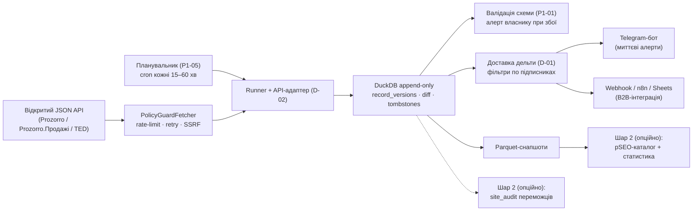

# План запуску першого дата-продукту на базі DaaS Intelligence Studio

> **Мета документа:** перетворити аналіз ринку ([`00_MARKET_DEMAND.md`](./00_MARKET_DEMAND.md),
> [`Монетизація даних та пасивний дохід.pdf`](./Монетизація%20даних%20та%20пасивний%20дохід.pdf))
> та поточні можливості студії ([`03_IMPLEMENTATION_PLAN.md`](./03_IMPLEMENTATION_PLAN.md)) на
> конкретний, не переускладнений план запуску першого комерційного продукту за **4 тижні** з
> мінімальними витратами на інфраструктуру та підтримку.
>
> Усі технічні зміни виконуються за процесом **Spec-Driven Development** ([`specs/README.md`](../specs/README.md)).

---

## 1. Головний вибір: з чого стартувати

### Обраний перший продукт
**«Алерт-сервіс та B2B-тригери по відкритих тендерах і аукціонах»** (Alerts-as-a-Service + періодичні вибірки):

- **Базовий трек (Україна — найшвидші перші клієнти):**
  1. **Prozorro.Продажі (аукціони майна, землі, оренди, авто, спецтехніки):** миттєві фільтровані Telegram-алерти про нові лоти, зміну стартової ціни (`price_drop`), наближення дедлайну.
  2. **Prozorro (публічні закупівлі — B2B-тригери):**
     - для постачальників: алерти за CPV-кодами, регіоном, сумою та зміною статусу;
     - для B2B-продажів і субпідрядників: **сигнал «компанія щойно виграла тендер на >1 млн грн»** + автоматичне збагачення її сайту, контактів і технологій наявним модулем `site_audit`.
- **Альтернативний/другий трек (глобальний ринок у USD/EUR на тому ж рушії):**
  - Джерела: відкриті API держзакупівель **TED Europa** (ЄС) або **SAM.gov** (США).
  - Дистрибуція: **Apify Store** (Actor) або **RapidAPI** + Telegram/Webhook-сповіщення.
  - Кодова база збігається на ~90%: змінюється лише адаптер мапінгу JSON-полів.

### Чому саме цей варіант, а не інші

| Варіант продукту | Готовність у студії зараз | Антибот і підтримка | Швидкість перших грошей | Вердикт |
|:---|:---|:---|:---|:---|
| **1. Відкриті тендери й аукціони (Prozorro / TED / SAM.gov)** | **Висока:** пресет `tender`, DuckDB-історія, diff і tombstones (`P1-03`), комплаєнс (`P1-04`) уже готові. Потрібно: `D-02` + `P1-05` + `D-01`. | **Низька складність:** офіційний відкритий JSON API, нуль Cloudflare, нуль проксі, 1–2 год/тиждень на підтримку. | **1–2 місяці** (Telegram-підписка \$15–\$49/міс або Apify/RapidAPI). | **Обрано для старту** |
| **2. Моніторинг цін у вузькій B2B e-commerce ніші** (запчастини, будматеріали, спецтехніка) | **Висока** лише для сайтів без JS/Cloudflare (`price_drop` уже працює). | **Середня:** ризик змін верстки та WAF на окремих донорах. | **1–2 місяці**, якщо вже є конкретний знайомий бізнес-покупець. | **Запасний варіант №2** |
| **3. Локальний B2B pSEO-довідник + аудит сайтів** (клініки, СТО, підрядники) | **Максимальна прямо зараз** (фактично вже реалізовано в демо). | **Низька–середня** (якщо джерела — відкриті каталоги / OSM, не Google Maps напряму). | **4–8 місяців** для SEO-трафіку. | **Другий шар** (вітрина + збагачення компаній із варіанту №1) |
| **4. Парсер Rozetka / Prom.ua** ([`04_MARKETPLACE_PARSER_CONCEPT.md`](./04_MARKETPLACE_PARSER_CONCEPT.md)) | **Низька для продакшну:** бракує проксі (`P1-06`), Playwright (`P1-07`), обробки GraphQL/lazy-load. | **Висока:** постійна боротьба з антиботом і ризики ToS. | Довгий MVP (4–6 тижнів) + дорога підтримка. | **Відкласти до Фази 3** |

---

## 2. Що вже готово в `daas-intelligence-studio`, а що треба додати

### Уже працює (перевикористовуємо без переписування)

| Компонент | Де в коді | Роль у першому продукті |
|:---|:---|:---|
| Пресет `tender` і схема колонок | `backend/app/presets.py`, `app/models.py` | Базова схема полів тендера/лота |
| Append-only історія, diff, tombstones | `backend/app/db/duckdb_store.py`, `app/pipeline/runner.py` | Автоматичне виявлення `new_entity`, `field_changed`, `price_drop`, `removed_entity` |
| Комплаєнс і безпека | `backend/app/compliance.py`, `app/scraping/politeness.py` | Logged-out, SSRF, rate-limit, аудит джерел |
| Стійка черга й raw-кеш (zstd) | `backend/app/db/sqlite_store.py`, `app/storage/raw_cache.py` | Надійні прогони, пере-екстракція без повторних запитів |
| Збагачення компаній | `backend/app/enrichment/site_audit.py`, `tech_detect.py` | Пошук контактів і стеку сайтів переможців тендерів (B2B-тригери) |
| Експорт із маніфестом + бекапи | `backend/app/storage/exports.py`, `app/storage/backup.py` | Готові XLSX/CSV/Parquet-вивантаження та добові бекапи |

### Мінімальні доопрацювання для MVP (3–4 компактні SDD-зміни)

Кожна задача відповідає пріоритетам беклогу з [`03_IMPLEMENTATION_PLAN.md` §6](./03_IMPLEMENTATION_PLAN.md#6-беклог-із-пріоритетами) і водночас підсилює саму студію:

| Порядок | SDD-зміна (`specs/changes/`) | ID беклогу | Що саме додає |
|:---:|:---|:---:|:---|
| 1 | `001-d02-open-api-source` | `D-02` | Конектор відкритого JSON API (пагінація за `offset`/курсором, проходження через `PolicyGuardFetcher`, декларативний мапінг JSON → `ExtractedRecord`) для Prozorro / Prozorro.Продажі (і розширюваний під TED/SAM.gov). |
| 2 | `002-p1-05-scheduler` | `P1-05` | Планувальник (`cron` на задачу, наприклад кожні 15–60 хв), пропуск при активному прогоні, доганяючий запуск після рестарту. |
| 3 | `003-d01-delta-delivery` | `D-01` | Канали доставки дельти після снапшоту: **Webhook** (універсальний JSON для n8n/Zapier/CRM) + **Telegram Bot API** (фільтри за ключовими словами, регіоном, сумою + службовий алерт власнику при збої або 0 записах). |
| 4 | `004-p1-01-quality-guards` | `P1-01` (MVP) | Автоматична перевірка якості після прогону (аномальне падіння кількості записів, порожні обов'язкові поля, офлайн-фікстури JSON API як регресійний gold-set). |

> **Принцип простоти:** для запуску MVP **не потрібні** Playwright, проксі-пул, платний LLM, Kubernetes, Postgres чи складний портал із ролями. Усе працює на одному VPS із SQLite + DuckDB.

---

## 3. Архітектура продукту

---

## 4. Модель монетизації та економіка

### Двошарова стратегія (з поєднанням швидких грошей і пасивного активу)

1. **Шар 1 — швидка монетизація (перші гроші за 1–2 місяці):**
   - **Free:** 1 фільтр, щоденний дайджест із затримкою (воронка залучення).
   - **Pro (\$19–\$29/міс або 790–1 190 грн/міс):** миттєві алерти в Telegram (15–30 хв), до 10 фільтрів (регіон, CPV/категорія, ціна, ключові слова), історія змін ціни, експорт у XLSX.
   - **B2B / Agency (\$49–\$99/міс):** webhook / Google Sheets, тригери переможців тендерів + збагачені контакти сайтів компаній.
   - *Якщо обрано глобальний трек:* публікація API/збирача на **Apify Store** (Pay-per-event / rental) або **RapidAPI** (платформа бере на себе білінг і первинний трафік).

2. **Шар 2 — пасивний актив (горизонт 4–8 місяців):**
   - Статичний **pSEO-довідник** поверх Parquet-снапшотів (спершу 30–50 пілотних сторінок для перевірки індексації).
   - Кожна сторінка дає **унікальну додану цінність** (щоб не потрапити під фільтр пошуковиків): середня ціна/знижка в категорії, графік динаміки кількості лотів, топ замовників/регіонів, актуальні лоти за тиждень.
   - Непряма монетизація: кнопка «Отримувати миттєві сповіщення в Telegram» (безкоштовна воронка у платний бот) + партнерські програми (юридичний супровід аукціонів, банківські гарантії, брокерські послуги).

### Орієнтовні витрати на запуск і підтримку

| Стаття витрат | На старті (місяць 1–3) | Примітка |
|:---|:---|:---|
| VPS (2 vCPU, 2–4 ГБ RAM, 40 ГБ SSD) | **\$5–\$7 / міс** | Hetzner / DigitalOcean; достатньо для SQLite + DuckDB + бота |
| Проксі та антибот | **\$0** | Відкритий офіційний API не потребує проксі |
| LLM-витрати | **\$0** | Детермінований JSON-мапінг; LLM опційно лише на B2B-тарифі |
| Домен (для pSEO / лендінгу) | **\$10–\$15 / рік** | Можна додати на 3–4 тижні, для Telegram-бота не обов'язково |
| Час на підтримку після запуску | **2–3 год / тиждень** | Завдяки авто-алертам про збої та стабільній схемі API |

---

## 5. Покроковий план запуску (4 тижні)

### Тиждень 0 (3–5 днів) — Валідація попиту ДО написання коду
Мета: підтвердити, що люди реально хочуть отримувати ці алерти, і зафіксувати вузьку піднішу.

- [ ] Зафіксувати 1 конкретну піднішу для старту (не «всі тендери України одразу», а наприклад: *«Prozorro.Продажі: оренда та продаж комерційної нерухомості/землі»* або *«Prozorro: ІТ / будматеріали / медтехніка»* або *«EU TED: ІТ-контракти»*).
- [ ] Проаналізувати 3–5 наявних ботів/сервісів у цій ніші: тарифи, затримка сповіщень, якість фільтрів, скарги користувачів.
- [ ] Зробити 1 просту посадкову сторінку або пост-опитування у 3–5 профільних Telegram-чатах / форумах / LinkedIn-групах:
  > «Тестую швидкий бот миттєвих сповіщень про нові лоти / зниження ціни в [ніша] без спаму. Шукаю 10 бета-тестувальників на 2 тижні безкоштовно».
- [ ] Зібрати **5–10 реальних запитів** (які саме фільтри й поля потрібні людям) — це стане вхідними вимогами для `spec.md`.

### Тиждень 1 — Конектор відкритого API (`D-02`)
Мета: `daas-intelligence-studio` стабільно збирає реальні дані з API, версіонує їх у DuckDB і рахує дельту.

- [ ] Створити специфікацію `specs/changes/001-d02-open-api-source/{spec,plan,tasks}.md` за шаблонами `specs/_templates/`.
- [ ] Додати офлайн-фікстури реальних JSON-відповідей API у `backend/tests/fixtures/` (тести строго офлайн).
- [ ] Реалізувати JSON API-джерело з курсорною пагінацією через `PolicyGuardFetcher` та інкрементальним довантаженням лише змінених записів (`dateModified` / курсор).
- [ ] Забезпечити стабільний `record_key` (наприклад, офіційний `tender_id` / `lot_id`), щоб `price_drop`, `field_changed` і `removed_entity` працювали без хибних спрацювань.
- [ ] Прогнати `make specs-check test lint build`, синхронізувати `specs/capabilities/` та архівувати `001`.

### Тиждень 2 — Планувальник (`P1-05`) і доставка дельти (`D-01`)
Мета: дані оновлюються автоматично за розкладом, а релевантні зміни приходять у Telegram і на Webhook.

- [ ] Створити `specs/changes/002-p1-05-scheduler/` → реалізувати `cron`-розклад на задачу з захистом від накладання прогонів та подіями в журналі.
- [ ] Створити `specs/changes/003-d01-delta-delivery/` → реалізувати:
  - доставку дельти на **Webhook** (JSON-пакет змін + ретраї);
  - доставку в **Telegram Bot API** із простою фільтрацією (категорія/CPV, регіон, мін./макс. сума, ключові слова, тип зміни);
  - дедуплікацію сповіщень (щоб одна й та сама подія не надсилалась двічі після рестарту);
  - службовий алерт власнику при помилці прогону або 0 зібраних записів.
- [ ] Прогнати `make specs-check test lint build`, синхронізувати спеки та архівувати `002` і `003`.

### Тиждень 3 — Контроль якості, деплой і закрита бета
Мета: сервіс працює 24/7 на VPS, бета-користувачі щодня отримують корисні сповіщення.

- [ ] Створити `specs/changes/004-p1-01-quality-guards/` (базова валідація схеми й порогів аномалій + регресійний тест точності на фікстурах).
- [ ] Налаштувати деплой на 1 VPS (systemd або Docker Compose) + автоматичний щоденний `daas backup` із вивантаженням копії в об'єктне сховище (S3/R2/Backblaze B2).
- [ ] Підключити 5–10 бета-користувачів із Тижня 0 (ручне або просте командне налаштування фільтрів у Telegram-боті).
- [ ] За 5–7 днів зібрати фідбек: які алерти були найціннішими, що дратувало (шум, брак поля, формат повідомлення) → швидко докрутити.

### Тиждень 4 — Перша монетизація і запуск Шару 2
Мета: отримати перші платні підписки і закласти довгостроковий канал трафіку.

- [ ] Підключити прийом оплат:
  - для України: **Monobank / WayForPay / LiqPay** (підписка або помісячне посилання на оплату на старті);
  - для глобального ринку: **Paddle / Stripe** або публікація на **Apify Store / RapidAPI**.
- [ ] Запропонувати бета-користувачам перехід на платний тариф зі знижкою «early adopter» (наприклад, −50% на перші 3 місяці).
- [ ] Розширити дистрибуцію: кейс/демо-пост у тематичних спільнотах із реальним прикладом («як бот спіймав зниження стартової ціни на 25% за 10 хвилин після публікації»).
- [ ] *Опційно (Шар 2):* згенерувати 30–50 пілотних сторінок статичного pSEO-каталогу з Parquet-снапшотів (агрегована статистика + посилання на бота) і додати їх у Google Search Console.

---

## 6. Комплаєнс, юридична гігієна та ризики

1. **Non-PII за замовчуванням:** збираємо виключно публічні дані про юридичних осіб, лоти, ціни, статуси, CPV-коди та дедлайни. Поля `pii="personal"` не збираються й не експортуються.
2. **Logged-out і ввічливість:** робота лише з відкритими публічними API без облікових записів, із повагою до rate-limit та `Retry-After`.
3. **Управління ризиками:**

| Ризик | Ознака | Мітигація |
|:---|:---|:---|
| Немає платоспроможного попиту в обраній підніші | На Тижні 0 менше 3–5 зацікавлених бета-тестерів | Змінити піднішу або перейти на глобальний трек (TED/SAM.gov/Apify) **до** написання коду |
| API тимчасово змінює формат або повертає 5xx | 0 записів або зростання помилок валідації | Службовий Telegram-алерт власнику + raw-кеш зберігає останні сирі відповіді |
| Забагато «шуму» в алертах користувача | Користувачі вимикають звук у боті | Жорсткі фільтри (сума, регіон, стоп-слова) + режим дайджесту |
| Один writer DuckDB при паралельних запусках | Помилка блокування БД | Планувальник працює всередині процесу `daas serve` з єдиним lock; бекап через `POST /api/maintenance/backup` |

---

## 7. Критерії Go / No-Go після перших 30 днів після запуску

- **Go (масштабуємо нішу + вкладаємось у pSEO / B2B-тариф):**
  - є щонайменше **3–5 платних підписників** або **20+ активних щотижневих користувачів**, які повертаються й просять нові фільтри;
  - підтримка займає ≤ 3 годин на тиждень.
- **Pivot (залишаємо рушій, міняємо джерело/нішу):**
  - технічно все працює стабільно, але конверсія у платний тариф = 0 → переносимо той самий пайплайн (`D-02` + `P1-05` + `D-01`) на глобальний API (TED EU / SAM.gov) або нішевий моніторинг цін (Варіант №2) і публікуємо на Apify/RapidAPI.

---

## 8. Рішення перед стартом (зафіксовано 2026-11-23)

1. **Географія:** `[x]` Україна (`Prozorro` + `Prozorro.Продажі`, спільний OpenProcurement-профіль) / `[ ]` Глобальний ринок (`TED EU` / `SAM.gov`)
2. **Вузька підніша №1:** **Prozorro + Prozorro.Продажі** (аукціони й тендери за фільтрами; вузькі підкатегорії тестуємо на Тижні 0).
3. **Перший канал монетизації:** `[x]` Telegram-підписка (алерти + фільтри) / `[ ]` Apify або RapidAPI / `[ ]` B2B Webhook + Sheets
4. **Інтерфейс для кроку `001`:** спершу бекенд / API / CLI + пресет із промпту (UI-форма налаштування API — окремою зміною).
5. **Цільовий день запуску бети:** `T + 21 день` (орієнтовно середина грудня 2026).
