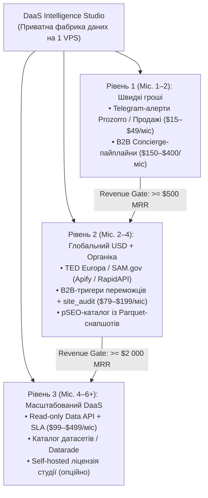

# Аналіз проєкту DaaS Intelligence Studio та план розвитку й монетизації

> **Дата аудиту:** 24 листопада 2026  
> **Стан репозиторію:** усі задачі Фази 0 та Фаз 1–3 (`001`–`012`, включно з `P1-01`…`P1-10`, `D-01`, `D-02`, VPS deploy) реалізовані й архівовані в [`specs/changes/archive/`](../specs/changes/archive/).  
> **Ключовий висновок:** проєкт технічно **переріс** MVP і готовий заробляти вже зараз, але має **0% комерційної валідації**. Найвищий ROI найближчих 30 днів — не нові фічі `P2/P3`, а запуск продажів через модель **«Студія як внутрішня фабрика даних»**.
>
> **Пов'язані документи:** [`00_MARKET_DEMAND.md`](./00_MARKET_DEMAND.md), [`03_IMPLEMENTATION_PLAN.md`](./03_IMPLEMENTATION_PLAN.md), [`04_MARKETPLACE_PARSER_CONCEPT.md`](./04_MARKETPLACE_PARSER_CONCEPT.md), [`05_FIRST_PRODUCT_LAUNCH_PLAN.md`](./05_FIRST_PRODUCT_LAUNCH_PLAN.md), [`specs/README.md`](../specs/README.md).

---

## 1. Чесний аудит поточного стану (As-Is)

### 1.1. Що вже побудовано (факти з кодової бази)

Проєкт не є «сирим прототипом» — це повноцінний, добре структурований local-first data-комбайн:

| Метрика / шар | Фактичний стан | Ключові файли |
|:---|:---|:---|
| Обсяг і стек | ~23 500 рядків коду (Python 3.11–3.13 / FastAPI / DuckDB / SQLite WAL + React 19 / TypeScript / TanStack Table) | [`backend/pyproject.toml`](../backend/pyproject.toml), [`backend/app/main.py`](../backend/app/main.py) |
| Якість і тести | **279 офлайн-тестів** (pytest), **56/56 перевірок** SDD-трасованості (`make specs-check`) | [`specs/README.md`](../specs/README.md), [`backend/tests/test_specs_traceability.py`](../backend/tests/test_specs_traceability.py) |
| Збір даних | Двофазний парсинг (JSON-LD + евристичний CSS-learner + guarded LLM fallback), OpenProcurement / REST JSON API (`D-02`), ProxyPool + Circuit Breaker (`P1-06`), детектор порожнього JS-DOM + Playwright Docker-сайдкар (`P1-07`) | [`backend/app/extraction/api_json.py`](../backend/app/extraction/api_json.py), [`backend/app/scraping/resilience.py`](../backend/app/scraping/resilience.py), [`backend/app/scraping/js_render.py`](../backend/app/scraping/js_render.py) |
| Історія та якість | Append-only `record_versions` у DuckDB, консервативні tombstones (`removed_entity`), Parquet-снапшоти, `price_drop`/`field_changed`, авто-інваріанти якості + gold-set F1 eval (`P1-01`), карантин (`P1-08`), Entity Resolution merge/unmerge (`P1-02`) | [`backend/app/db/duckdb_store.py`](../backend/app/db/duckdb_store.py), [`backend/app/pipeline/quality.py`](../backend/app/pipeline/quality.py), [`backend/app/enrichment/dedupe.py`](../backend/app/enrichment/dedupe.py) |
| Збагачення | Аудит сайту (`site_audit`: email, телефони, соцмережі, онлайн-запис), детектор технологій (`tech_detect`), пошук домену (`domain_resolver` через SearXNG), AI-колонки з контролем бюджету LLM | [`backend/app/enrichment/site_audit.py`](../backend/app/enrichment/site_audit.py), [`backend/app/enrichment/ai_column.py`](../backend/app/enrichment/ai_column.py) |
| Автоматизація і доставка | Cron-планувальник із catch-up (`P1-05`), доставка дельти в Telegram Bot API і HMAC-підписані Webhooks із дедуплікацією та ретраями (`D-01`), експорт CSV/XLSX/Parquet/JSON із маніфестом і sha256 | [`backend/app/pipeline/scheduler.py`](../backend/app/pipeline/scheduler.py), [`backend/app/pipeline/delivery.py`](../backend/app/pipeline/delivery.py), [`backend/app/storage/exports.py`](../backend/app/storage/exports.py) |
| Комплаєнс і Ops | Примусовий ToS-реєстр (`forbidden`/`high`), logged-out only, SSRF-захист, обов'язкове маскування `pii="personal"`, `/api/metrics` (Prometheus), Docker + Caddy + systemd + бекап у S3/R2/B2 (`006`) | [`backend/app/compliance.py`](../backend/app/compliance.py), [`deploy/README.md`](../deploy/README.md) |

### 1.2. Головні конкурентні переваги (Moat)

1. **Економіка збору близька до нуля.** Детермінований JSON API / JSON-LD / CSS-шлях дає собівартість інфраструктури **$5–$10/міс** (один VPS), що дозволяє мати валову маржу **85–95%** на підписках.
2. **Історія змін — актив, який конкурент не може «спарсити заднім числом».** Append-only `record_versions` + Parquet-снапшоти + `raw_cache` (zstd) щодня накопичують історичну цінність.
3. **Юридична захищеність на рівні архітектури.** Принцип *Logged-out + Non-PII + Provenance + Manifest* ([`specs/constitution.md`](../specs/constitution.md)) знімає головний блокер для продажів B2B-компаніям у ЄС/США та Україні.
4. **Дисципліна SDD і низький ризик регресій.** Наявність специфікацій і 279 офлайн-тестів дозволяє вносити комерційні зміни за години, а не тижні.

### 1.3. Головний стратегічний ризик прямо зараз

> [!WARNING]
> **Синдром передчасного інжинірингу (Build-trap).**  
> У [`05_FIRST_PRODUCT_LAUNCH_PLAN.md`](./05_FIRST_PRODUCT_LAUNCH_PLAN.md) усі технічні кроки Тижнів 1–3 (і навіть 6 додаткових змін Фази 3 — `007`–`012`) уже позначені `[x]`, тоді як **усі бізнес-кроки** (Тиждень 0: валідація попиту, 5–10 бета-тестерів, живий деплой, оплата) досі `[ ]`.  
> Перехід зараз до `P2/P3` (Splink, LanceDB, клієнтський портал, багатопроцесність) **без живих платних клієнтів** гарантовано призведе до втрати 2–4 місяців на функціонал, за який ринок може не заплатити.

### 1.4. Конкретні технічні прогалини на шляху до перших грошей (Go-to-Market Gaps)

Аналіз коду виявив **5 точкових прогалин**, які реально відокремлюють поточну кодову базу від стабільного заробітку:

1. **Telegram-доставка є односторонньою (outbound-only).** `DeltaDispatcher` у [`backend/app/pipeline/delivery.py`](../backend/app/pipeline/delivery.py) надсилає алерти в `chat_id`, але немає клієнтського Telegram-бота (`/start`, керування фільтрами, перегляд тарифу, кнопка оплати).
2. **Занадто грубі фільтри підписок для Prozorro.** `DeliveryFilters` у [`backend/app/models.py`](../backend/app/models.py) підтримує лише `event_types`, `keywords` (пошук OR по всіх полях), `min_amount`/`max_amount`. Для реальних покупців критично бракує:
   - фільтрації за префіксами `cpv`, конкретним `region` і `status`;
   - стоп-слів (`exclude_keywords`), без яких алерти перетворюються на спам;
   - режиму **дайджесту** (раз на день для Free-тарифу) vs **миттєвого алерту** (для Pro);
   - коректної подачі >10 змін (зараз `_format_telegram_delta` обрізає повідомлення на 10 позиціях без посилання або XLSX-файлу).
3. **У Prozorro-профілі немає полів переможця (awards/contracts).** У [`backend/app/presets.py`](../backend/app/presets.py) мапляться лише дані замовника (`procuringEntity.*`), а не переможця (`awards.0.suppliers.0.*`). Водночас найдорожчий B2B-тригер («компанія щойно виграла тендер >1 млн грн + авто-аудит її сайту через `site_audit`») потребує саме цих полів.
4. **Архітектура single-tenant / single-writer DuckDB.** [`backend/app/main.py`](../backend/app/main.py) має один токен і одного writer-а DuckDB. Це **недолік**, якщо продавати саму студію як публічний SaaS, але **перевага**, якщо продавати **дані й алерти** (студія працює приватно як Data Factory).
5. **Дрібний техборг зі [`specs/README.md` §6](../specs/README.md#6-що-виявлено-під-час-зняття-спек-потребує-рішення-людини):** 500 замість 400 на невалідний `f_<key>`, `Crawl-delay` для `www.*`, відсутність режиму refresh при повторному збагаченні, повторювана подія `llm_limit`, прогалини тестів (formula injection, path traversal, `RobotsGate`). Не блокують старт продажів, але мають закриватися по ходу експлуатації.

---

## 2. Стратегічна модель: як саме монетизувати проєкт

Не намагайтеся продавати «ще один скрейпер» або «UI для парсингу» — цей ринок перенасичений (Apify, Bright Data, Browse AI, Firecrawl). Згідно з дослідженням у [`00_MARKET_DEMAND.md`](./00_MARKET_DEMAND.md), гроші лежать у **регулярних бізнес-сигналах** та **збагачених даних під ключ**.

Рекомендована трирівнева архітектура монетизації (кожен наступний рівень фінансується з доходу попереднього):

### Чому варто поєднати 2 паралельні потоки на старті (Місяць 1)

| Потік | Кому продаємо | Чек | Час до перших грошей | Роль у стратегії |
|:---|:---|:---|:---|:---|
| **Потік A — Масова підписка (Prozorro / Prozorro.Продажі)** | Брокери, інвестори в землю/майно/авто, постачальники держзакупівель | **$15–$49 / міс** | 2–4 тижні | Масштабований recurring-дохід, перевірка продуктового попиту, база для pSEO |
| **Потік B — B2B Concierge / DaaS під ключ (2–4 клієнти)** | E-commerce бренди (ціни конкурентів), B2B-агенції (збагачені ліди + intent-сигнали), субпідрядники | **$150–$400 / міс** за потік у Google Sheets / CRM / Telegram | **1–2 тижні** | Швидкий кешфлоу, який покриває витрати й час розробки, поки росте Потік A; перевірка вже готових `Playwright` + `Proxy` + `site_audit` |

> [!TIP]
> **Критично для Потоку B:** продавайте **НЕ** одноразовий парсинг (де на Upwork/Freelancehunt демпінг $80–$200), а **щомісячну підписку на свіжий потік даних** («щоденний моніторинг 500 SKU ваших конкурентів із Telegram-алертом про демпінг >5% та таблицею історії цін — $250/міс»). Уся технічна начинка (`price_drop`, `scheduler`, `webhook`, `playwright-sidecar`, `proxy-pool`) уже написана.

---

## 3. Детальний план розвитку та монетизації (6 місяців)

### Фаза 0 (Дні 1–10): «Feature Freeze» → Живий VPS + Валідація попиту

**Головне правило:** жодного нового коду, поки студія не крутиться на живому VPS і не проведено 10 розмов із потенційними клієнтами.

1. **Інфраструктура (Дні 1–2):**
   - Орендувати VPS (Hetzner CX22: 2 vCPU / 4 GB RAM / 40 GB SSD — ~€4.5/міс) + домен (~$10/рік).
   - Розгорнути студію через [`docker-compose.prod.yml`](../docker-compose.prod.yml) + Caddy HTTPS + щоденний бекап у Cloudflare R2 (безкоштовний tier до 10 ГБ) за [`deploy/README.md`](../deploy/README.md).
   - Налаштувати 2 бойові задачі в студії на реальних API:
     - **Prozorro.Продажі** (аукціони нерухомості / землі / авто — оновлення кожні 15 хв);
     - **Prozorro** (публічні закупівлі — оновлення кожні 15–30 хв).
   - Увімкнути службові Telegram-алерти власнику (`notify_on_error=true`) і перевірити `/api/metrics`.
   - *Результат:* реальні заміри швидкості інкрементального курсора, обсягу DuckDB за добу та стабільності мапінгу JSON.

2. **Вибір 1–2 вузьких підніш і залучення бети (Дні 3–7):**
   - Не продавати «усі тендери України» — обрати **1–2 найгрошовитіші вертикалі**, де рішення приймають швидко:
     - *Варіант 1 (Prozorro.Продажі):* оренда/продаж комерційної нерухомості, землі та спецтехніки (цільова аудиторія — брокери, інвестори, агробізнес; критично важливі `new_entity` і `price_drop` на голландських аукціонах).
     - *Варіант 2 (Prozorro B2B):* постачальники будматеріалів / ІТ / медтехніки / палива + тригери переможців для субпідрядників і логістів.
   - Провести швидкий конкурентний аудит 3–5 існуючих ботів (Clarity, Zakupivli.Pro, SmartTender, локальні TG-боти): затримка алертів, ціна, незручність фільтрів, наявність історії падіння цін.
   - Опублікувати оффер на безкоштовну 14-денну бету в 5–10 профільних Telegram-чатах, Facebook-групах брокерів/інвесторів і написати 20–30 прямих повідомлень у LinkedIn (керівникам тендерних відділів і B2B-продажів).
   - Підключити **5–10 бета-тестерів вручну** (Concierge-режим: берете їх `chat_id` і бажані фільтри, додаєте підписку в UI [`AutomationPanel.tsx`](../frontend/src/components/AutomationPanel.tsx) за 30 секунд).

3. **Паралельний запуск Потоку B — Concierge B2B (Дні 5–10):**
   - Підготувати 2 демонстраційні семпли (XLSX + скріншот Telegram-алерту про зміну ціни + маніфест якості):
     1. *Моніторинг цін і наявності конкурентів у вузькій e-commerce ніші* (50–200 SKU).
     2. *База переможців тендерів із перевіреними сайтами, контактами й технологіями*.
   - Зробити 15–20 адресних звернень до власників інтернет-магазинів / B2B-агенцій (Україна + Upwork/LinkedIn під позиціонуванням *RevOps / Automated Price & Lead Intelligence*).

**Вихідний критерій Фази 0:** VPS працює 7 днів без ручного втручання; є ≥5 живих бета-тестерів, які реально читають алерти і дали зворотний зв'язок.

---

### Фаза 1 (Дні 11–30): Перші платні підписки (Ціль: $300–$1 000 MRR)

На основі реального фідбеку з Фази 0 виконуємо **лише 3 точкові SDD-зміни**, що напряму розблоковують оплату:

1. **SDD `013-delivery-filters-and-digest` (3–4 дні):**
   - Розширити `DeliveryFilters` у [`backend/app/models.py`](../backend/app/models.py): додати `exclude_keywords` (стоп-слова), точну фільтрацію по полях (`field_filters: dict[str, list[str]]` — для `cpv` за префіксом, `region`, `status`).
   - Додати режим `delivery_mode: "instant" | "digest_daily"` (накопичення змін за добу для Free-тарифу та анти-спам режиму).
   - Покращити Telegram-форматування: клікабельні заголовки, сума з розділювачами, дельта ціни, а при >10 змінах — надсилання компактного CSV/XLSX документом через `sendDocument`.
2. **SDD `014-prozorro-winners-b2b-triggers` (2–3 дні):**
   - Додати в [`backend/app/presets.py`](../backend/app/presets.py) профіль **Prozorro Winners (B2B Intent)**: витягування `winner_name`, `winner_edrpou`, `award_amount`, `award_status` (`awards.0.suppliers.0.*`).
   - Зв'язати тригер нового переможця (сума > порогу) з автоматичним викликом `domain_resolver` + `site_audit` + `tech_detect` (з дотриманням `pii="business_contact"`).
   - *Бізнес-ефект:* формує продукт з чеком у 3–5× вищим за звичайні тендерні алерти.
3. **SDD `015-telegram-subscriber-bot` (4–5 днів, робити лише якщо є ≥10 активних користувачів):**
   - Легкий окремий сервіс-бот (у `deploy/` або `backend/app/bot/`), який спілкується зі студією через її існуючий REST API (`/api/tasks/{id}/subscriptions`), не торкаючись DuckDB напряму (зберігаємо ADR-02).
   - Команди: `/start`, вибір категорії/регіону/бюджету/стоп-слів, вибір режиму (`instant`/`digest`), 7-денний Free Trial, `/upgrade` (платіжне посилання), `/pause`.

#### Тарифна сітка (Місяць 1)

| Тариф | Ціна | Що входить | Мета |
|:---|:---|:---|:---|
| **Free** | $0 | 1 фільтр, 1 щоденний дайджест о 09:00, затримка 24 год | Воронка залучення, віральність у чатах |
| **Pro (Алерти)** | **$19/міс** (790 грн) | Миттєві алерти (15 хв), до 10 фільтрів + стоп-слова, трекінг `price_drop`, експорт тижневої вибірки в XLSX | Основний масовий recurring-потік |
| **B2B Intent (Переможці + Webhook)** | **$69/міс** (2 900 грн) | Усе з Pro + тригери переможців тендерів >1 млн грн + авто-аудит сайтів (`site_audit`) + Webhook у CRM / Google Sheets / n8n | Високомаржинальний B2B-сегмент |
| **Concierge Custom Feed** | **$199–$399/міс** | Індивідуальне джерело (конкурентні ціни / каталог / реєстр), підтримка верстки, доставка в Sheets/API/Telegram | Швидкий кешфлоу на старті |

#### Прийом оплат без зайвої розробки
- **Україна:** Monobank Acquiring (інвойс-посилання / підписка через ФОП 3 групи) або WayForPay — підключається за 1 день, webhook автоматично активує/продовжує підписку в боті.
- **Глобально:** Paddle або Lemon Squeezy (Merchant of Record — самі закривають VAT/податки у ЄС та США) або прямі інвойси для B2B Concierge.
- **Оффер конверсії бети:** на 10–12 день бети кожному активному користувачу пропозиція *Founding Member* — **−50% назавжди** (напр. 395 грн/міс) за умови оплати протягом 72 годин + короткий відгук.

**Go / No-Go Гейт (День 30):**
- **GO:** є ≥5 платних клієнтів Pro АБО ≥2 клієнти B2B/Concierge (сумарно **≥$300–$500 MRR**), підтримка займає ≤3 год/тиждень.
- **PIVOT:** якщо Prozorro-підписка дає 0 оплат за 30 днів — не «допилювати» інтерфейс, а за 3 дні переключити той самий рушій (`api_json` + `scheduler` + `delivery`) на **глобальний API (TED Europa / SAM.gov)** або сфокусуватися на **B2B Price Intelligence**.

---

### Фаза 2 (Місяці 2–3): Диверсифікація в USD/EUR та органічний трафік (Ціль: $1 500–$3 500 MRR)

Після проходження Гейту 30 днів масштабуємося у **трьох напрямках** (без переписування ядра):

1. **Глобальний трек — USD/EUR ринок (Місяць 2):**
   - **SDD `016-global-tenders-adapters`:** додати профілі для **TED Europa API** (держзакупівлі ЄС) та **SAM.gov Opportunities API** (федеральні контракти США) поверх існуючого [`backend/app/extraction/api_json.py`](../backend/app/extraction/api_json.py). Кодова база перевикористовується на ~90%.
   - **Портфельна стратегія на Apify Store / RapidAPI** (згідно з [`00_MARKET_DEMAND.md`](./00_MARKET_DEMAND.md)): опублікувати **серію з 3–4 вузьких взаємодоповнюючих сервісів** в одній індустрії (напр., *EU Tenders Watcher*, *EU Tender Winners + Website Tech Enricher*, *US Federal Contract Signals*) із моделлю *Pay-per-event / Monthly Rental*. Маркетплейс бере на себе білінг, довіру і первинний попит.

2. **Шар пасивного трафіку — pSEO-каталог поверх Parquet-снапшотів (Місяць 2–3):**
   - Генератор статичного сайту (Astro / Next.js SSG на Cloudflare Pages — **$0/міс** хостинг), який щоночі читає Parquet-снапшоти з R2.
   - Спочатку **50–100 пілотних сторінок** за формулою `[Категорія / CPV] + [Регіон]` (напр., *«Аукціони комерційної нерухомості Київ — статистика цін і нові лоти»*).
   - **Обов'язкова додана цінність** (захист від фільтрів Google): графік динаміки лотів, середня знижка на торгах, топ-5 замовників/регіонів, останні 10 актуальних лотів + CTA *«Отримувати такі лоти в Telegram за 15 хв»*.
   - Додаткова монетизація трафіку: партнерські ліди для юристів з тендерного супроводу та банківських гарантій (10–20% ревшари або фікс за лід).

3. **Вертикаль №2 — Нішевий B2B Price Intelligence (Місяць 3):**
   - Залучити 3–5 клієнтів на щоденний моніторинг цін/позицій/відгуків (використовуючи `P1-06` Proxy + `P1-07` Playwright Sidecar + `price_drop`).
   - Обов'язково дотримуватися висновків [`04_MARKETPLACE_PARSER_CONCEPT.md`](./04_MARKETPLACE_PARSER_CONCEPT.md): продавати **позиції в категорії, ціну, дельту відгуків, продавців Prom** — і чесно **не обіцяти** недоступні метрики (вподобайки, точні залишки на складі).
   - **SDD `017-google-sheets-delivery`:** додати третій канал доставки в `delivery.py` — пряме оновлення Google Sheets (або готовий n8n-шаблон поверх існуючого Webhook), бо 80% SMB-клієнтів хочуть бачити дані саме в таблицях.

4. **Закриття критичного техборгу з [`specs/README.md`](../specs/README.md#6-що-виявлено-під-час-зняття-спек-потребує-рішення-людини):**
   - Виправити 400 замість 500 на `f_<key>`, нормалізацію `www.*` у `Crawl-delay`, режим refresh для збагачення, дедуплікацію події `llm_limit`, а також закрити тестові прогалини безпеки (formula injection, path traversal, `RobotsGate`).

---

### Фаза 3 (Місяці 4–6): Платформенне масштабування (Ціль: $5 000–$10 000+ MRR)

> [!IMPORTANT]
> **Умова старту Фази 3:** стабільний дохід **≥$2 000 MRR** та підтверджений попит на API-доступ від ≥5 B2B-клієнтів.

Тут відкриваємо архітектурний беклог `P2/P3` із [`03_IMPLEMENTATION_PLAN.md`](./03_IMPLEMENTATION_PLAN.md):

1. **Розділення процесів (`P2-04`):** винесення фонового воркера збору окремим процесом і переведення API-читання на read-only DuckDB / репліку Parquet — знімає обмеження одного writer-а.
2. **Публічний Data API + Data Contracts (`P3-01`, `P3-03`):**
   - Окремий легкий сервіс (FastAPI + Postgres для ключів/білінгу + читання версіонованих Parquet з S3/R2).
   - Персональні API-ключі, rate-limiting, метеринг запитів, версіювання схеми датасету, changelog, гарантія свіжості (SLA).
   - Лістинг готових історичних датасетів на **Datarade** / **Snowflake Marketplace** (чеки від $500–$2 000/міс за корпоративну ліцензію).
3. **Клієнтський портал + Stripe/Paddle (`P3-02`):**
   - Вітрина дата-продуктів із живим прев'ю 20 рядків (PII автоматично замасковано через існуючий шар), кнопкою підписки, особистим кабінетом із API-ключем, вебхуками й історією рахунків.
4. **Enterprise Compliance Pack:**
   - `daas dsar --email ... --delete` (повне видалення по версіях/кешу/снапшотах), автоматичний retention job, експорт журналу аудиту походження даних (для великих клієнтів ЄС/США).
5. **Масштаб даних (лише за потреби >100k записів на датасет):**
   - `P2-01` Discovery (OSM/Overpass, sitemap, Open Data), `P2-02` FTS5/семантика, `P2-03` Splink batch ER.
6. **Опційна гілка — Open-Core / Self-Hosted ліцензія студії:**
   - Якщо з'явиться інтерес від data-інженерів і агенцій до самої студії: відкрити базове ядро (MIT/Apache) для бренд-трафіку та GitHub Stars, а продавати **Pro/Team ліцензію** ($49–$149/міс або $499/рік) із модулями: multi-user RBAC, Playwright/Proxy-оркестрація, Data API gateway, enterprise audit/DSAR.

---

## 4. Фінансова модель і Unit-економіка

### 4.1. Операційні витрати (OPEX)

| Стаття | Місяць 1 (MVP) | Місяць 3 (Ріст) | Місяць 6 (Масштаб) |
|:---|:---:|:---:|:---:|
| VPS / Сервери (Hetzner) | $6 | $20 | $60–$100 |
| Об'єктне сховище (Cloudflare R2 + бекапи) | $0 | $5 | $15–$30 |
| Домени, DNS, Cloudflare Pages (pSEO) | $1 | $2 | $5 |
| Проксі (лише під клієнтів Потоку B / e-commerce) | $0 | $30–$60 | $100–$200 |
| LLM API (лише на платних AI-колонках / B2B) | $0–$5 | $15–$30 | $50–$100 |
| Платіжні комісії (Monobank/Paddle ~3–6%) | ~$20 | ~$120 | ~$350 |
| **Разом OPEX** | **~$30/міс** | **~$220/міс** | **~$650/міс** |

**Точка беззбитковості на Місяці 1:** лише **2 підписники тарифу Pro** ($38) повністю покривають усю інфраструктуру.

### 4.2. Прогноз виручки (Базовий сценарій, 6 місяців)

| Канал | Міс. 1 | Міс. 2 | Міс. 3 | Міс. 4 | Міс. 6 |
|:---|:---:|:---:|:---:|:---:|:---:|
| Prozorro / Продажі Pro ($19/міс) | 8 кл. ($152) | 25 кл. ($475) | 50 кл. ($950) | 85 кл. ($1 615) | 150 кл. ($2 850) |
| B2B Intent + Webhook ($69/міс) | 1 кл. ($69) | 4 кл. ($276) | 10 кл. ($690) | 18 кл. ($1 242) | 30 кл. ($2 070) |
| Concierge Custom Feeds ($250/міс) | 1 кл. ($250) | 2 кл. ($500) | 3 кл. ($750) | 4 кл. ($1 000) | 5 кл. ($1 250) |
| Global (TED/SAM.gov · Apify/RapidAPI) | $0 | $100 | $350 | $800 | $1 800 |
| Data API / Партнерки pSEO | $0 | $0 | $100 | $350 | $1 200 |
| **Разом MRR** | **$471** | **$1 351** | **$2 840** | **$5 007** | **$9 170** |
| **Чистий прибуток (до податків)** | **~$440** | **~$1 200** | **~$2 620** | **~$4 550** | **~$8 500** |

---

## 5. Пріоритезований технічний SDD-беклог (прив'язаний до виручки)

Кожна нова зміна виконується за [`specs/README.md`](../specs/README.md) (`spec.md` → `plan.md` → `tasks.md` → тести → код → sync), але **запускається тільки після виконання тригера**:

| SDD ID | Зміна | Тригер запуску | Оцінка | Бізнес-ефект |
|:---|:---|:---|:---:|:---|
| `013` | `delivery-filters-and-digest` (CPV/регіон/стоп-слова/дайджест/XLSX-файл) — ✅ [`archive/013`](../specs/changes/archive/013-delivery-filters-and-digest/spec.md) | Фідбек ≥5 бета-тестерів (Тиждень 2) | S (3 дні) | Зменшує шум → різко підвищує конверсію Free→Pro і retention |
| `014` | `prozorro-winners-b2b-triggers` (awards + авто-`site_audit`) — ✅ [`archive/014`](../specs/changes/archive/014-prozorro-winners-b2b-triggers/spec.md) | Підтверджений інтерес ≥3 B2B-лідів | S (2–3 дні) | Відкриває тариф **$69/міс** (у 3.5× вищий чек) |
| `015` | `telegram-subscriber-bot` (тонкий self-service бот поверх REST API) — ✅ [`archive/015`](../specs/changes/archive/015-telegram-subscriber-bot/spec.md) | ≥10 активних користувачів або перші 3 оплати | M (4–5 днів) | Знімає ручний онбординг, вмикає авто-тріал і авто-оплату |
| `016` | `global-tenders-adapters` (TED Europa + SAM.gov) | Після $500 MRR або при Pivot | S (3 дні) | Вихід на платоспроможний ринок USD/EUR |
| `017` | `google-sheets-delivery` + n8n-шаблон | Запит ≥2 B2B/Concierge клієнтів | S (2–3 дні) | Спрощує продаж SMB-клієнтам без власних розробників |
| `018` | `tech-debt-hardening` (400 на `f_<key>`, `www.*` Crawl-delay, enrich refresh, тести безпеки) | Паралельно у Місяці 2 | S (2 дні) | Стабільність 24/7 та чистий аудит безпеки |
| `019` | `pseo-static-exporter` (генерація агрегованих JSON/MD з Parquet-снапшотів) | Після перших $1 000 MRR | S (3 дні) | Безкоштовний довгостроковий SEO-трафік у бот |
| `P2-04` | Окремий процес воркера + read-only DuckDB API | ≥$2 000 MRR або >20 активних cron-задач | L | Знімає обмеження single-writer |
| `P3-01..03` | Окремий Data API + портал + Stripe/Paddle + DSAR/SLA | ≥5 B2B-клієнтів із запитом на API | XL | Масштабування до $10k+ MRR і Datarade |

### Анти-скоуп: чого НЕ робити найближчі 60 днів

- Не будувати мультикористувацький SaaS-інтерфейс із логінами/ролями всередині поточної студії.
- Не впроваджувати Splink (`P2-03`), LanceDB (`P2-02`) і Kubernetes — DuckDB + SQLite на 1 VPS витримають десятки тисяч записів і сотні підписників.
- Не робити масовий парсер Rozetka/Prom «про запас» без конкретного передоплаченого клієнта Потоку B.
- Не витрачати тижні на редизайн UI студії — клієнти купують **сповіщення, таблиці й API**, а не адмінку.

---

## 6. Ключові ризики та мітигація

| Ризик | Ймовірність | Мітигація |
|:---|:---:|:---|
| **Слабкий попит у вузькій підніші Prozorro** | Середня | Валідація за 7 днів до коду; готовність за 3 дні перевести `api_json` на TED Europa / SAM.gov |
| **Високий churn у Telegram-боті через «шум»** | Висока | Стоп-слова + точні CPV/регіон фільтри (`013`) + дайджест-режим; відстежувати частку мутів/відписок |
| **Збій API або падіння парсера вночі** | Середня | Уже працює `quality_checks` + `notify_on_error` власнику + `/api/metrics` + щоденні R2-бекапи |
| **Ризик одного клієнта в Потоці B (Concierge)** | Середня | Використовувати Потік B як паливо (кешфлоу), а не єдиний канал; лімітувати кастомізацію до 1–2 год/клієнта |
| **Юридичні претензії / GDPR** | Низька | Суворе дотримання [`specs/constitution.md`](../specs/constitution.md) (Стаття V): лише публічні Open Data / logged-out дані, `pii="personal"` ніколи не експортується |

---

## 7. Конкретний план дій на найближчі 7 днів

- [ ] **День 1:** Орендувати VPS (Hetzner ~€4.5/міс), розгорнути [`docker-compose.prod.yml`](../docker-compose.prod.yml) + Caddy + R2 бекап. Перевірити `daas doctor` і `/api/health`.
- [ ] **День 2:** Створити 2 реальні задачі (`Prozorro.Продажі` + `Prozorro`), запустити cron кожні 15–30 хв, налаштувати службовий Telegram-алерт собі. Переконатися, що інкрементальний збір і `price_drop` стабільно працюють 24 год.
- [ ] **День 3:** Обрати **1 пріоритетну піднішу** (напр., *аукціони комерційної нерухомості та землі на Prozorro.Продажі* або *B2B-переможці будівельних/ІТ тендерів*). Зняти 2–3 реальні скріншоти свіжих алертів із бота.
- [ ] **Дні 4–5:** Написати оффер на безкоштовний 14-денний тест у 5–10 тематичних спільнотах + 20 адресних повідомлень у LinkedIn/Telegram. Мета — **5–10 живих бета-тестерів**.
- [ ] **Дні 5–6:** Паралельно зробити 1 семпл-вибірку для Потоку B (напр., моніторинг цін 50 SKU або збагачена база 100 компаній із `site_audit`) і надіслати 10–15 потенційним B2B-клієнтам з пропозицією щомісячного пілоту за $150–$250/міс.
- [ ] **День 7:** Зібрати перші відповіді бета-тестерів → зафіксувати реальні вимоги у `specs/changes/013-delivery-filters-and-digest/spec.md` (жодних здогадок — тільки те, що попросили живі користувачі).
