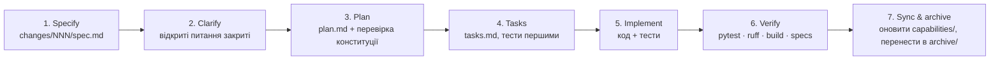

# Spec-Driven Development у DaaS Intelligence Studio

> **Специфікація — джерело правди про поведінку системи. Код і тести її реалізують і доводять.**
> Будь-яка зміна поведінки починається зі зміни спеки, а не з коду.

Цей каталог — обов'язковий робочий процес для людей і **всіх AI-агентів** (Claude Code, Codex,
Cursor, Copilot, Gemini тощо). Інструкції для агентів: [`/AGENTS.md`](../AGENTS.md).

---

## 1. Структура

```text
specs/
├── README.md               ← ви тут: процес, правила, індекс
├── constitution.md         ← незмінні принципи проєкту (перевіряються в кожному плані)
├── _templates/             ← шаблони: spec, plan, tasks
├── capabilities/           ← ЖИВІ спеки: як система поводиться ЗАРАЗ (as-built)
│   ├── 00-domain-model.md
│   ├── 01-task-planning.md
│   └── …
└── changes/                ← зміни в роботі: одна папка на фічу/фікс
    ├── README.md
    ├── NNN-slug/           ← spec.md → plan.md → tasks.md
    └── archive/            ← завершені зміни (історія рішень)
```

- **`capabilities/`** описує поточну поведінку. Після злиття зміни ці файли **оновлюються**, щоб
  знову відповідати коду. Їх не можна «випереджати» кодом і не можна залишати застарілими.
- **`changes/`** — пропозиції змін. Поки зміна не злита, вона живе тут, а не в `capabilities/`.

## 2. Життєвий цикл зміни



| Крок | Що робимо | Артефакт | Вихідний критерій |
|:---|:---|:---|:---|
| 1. Specify | **Що** і **навіщо**, без «як». Вимоги з ID, сценарії GIVEN/WHEN/THEN, поза скоупом | `changes/NNN-slug/spec.md` | Кожна вимога тестовна; дельта до `capabilities/` явна (ADDED/MODIFIED/REMOVED) |
| 2. Clarify | Відкриті питання → відповіді (від людини або з коду/доків) | розділ «Відкриті питання» у spec | Немає `[NEEDS CLARIFICATION]` |
| 3. Plan | **Як**: модулі, моделі, міграції, події, API, ризики | `plan.md` | Пройдено чекліст конституції; ADR, якщо рішення архітектурне |
| 4. Tasks | Упорядковані кроки; тест кожної вимоги йде **перед** реалізацією | `tasks.md` | Кожна REQ має хоча б одну задачу-тест |
| 5. Implement | Код за задачами; відхилення від плану → спершу правимо spec/plan | код + тести | Задачі відмічені |
| 6. Verify | `make test`, `make lint`, `make build`, `make specs-check` | зелений CI | Усі REQ мають посилання на тести |
| 7. Sync | Перенести дельту в `capabilities/*.md`, оновити `docs/03` (статус/беклог), перенести папку в `archive/` | оновлені спеки | `capabilities/` = поведінка коду |

### Коли можна скоротити процес

| Тип зміни | Що обов'язково |
|:---|:---|
| Нова фіча, зміна API/моделі/схеми БД, комплаєнс, безпека, PII | Повний цикл (spec → plan → tasks) |
| Баг-фікс, де код розходиться зі спекою | Тест, що відтворює баг + фікс. Спеку не міняємо (вона вже правильна) — лише посилання на новий тест |
| Баг-фікс, де спека сама неправильна/неповна | Спершу виправити вимогу в `capabilities/`, потім тест + фікс (можна без `changes/`, якщо < ~50 рядків коду) |
| Рефакторинг без зміни поведінки | Без нової спеки; усі наявні тести зелені; оновити розділ «Код» у спеці, якщо файли переїхали |
| Документація, опечатки, форматування | Без спеки |

**Сумнів = повний цикл.**

## 3. Формат вимог

Кожна вимога має стабільний ID `REQ-<ОБЛАСТЬ>-<NNN>`, нормативне слово і перевірку:

```markdown
### REQ-COMP-001 — Заборонене джерело зупиняє запуск
Система **ПОВИННА** відхилити калібрування і збір, якщо будь-який seed має `tos_risk=forbidden`.
- **Сценарій:** GIVEN домен `example.com` позначено `forbidden` WHEN `POST /api/tasks/{id}/run`
  THEN 403 `{code: "forbidden"}` і подія `compliance_blocked`.
- **Перевірка:** `tests/test_compliance.py::test_forbidden_source_is_a_hard_stop`
```

- Нормативні слова (RFC 2119): **ПОВИННА** (MUST), **НЕ ПОВИННА** (MUST NOT), **СЛІД** (SHOULD),
  **МОЖЕ** (MAY).
- Шляхи тестів — відносно `backend/` у форматі `` `tests/<файл>.py::<функція>` ``. Їх перевіряє
  `tests/test_specs_traceability.py`: посилання на неіснуючий тест ламає CI.
- Якщо тест покриває вимогу не повністю: `- **Перевірка (частково):** <тест> — що саме не покрито`.
- Якщо тесту ще немає: `- **Перевірка:** — (прогалина)` + рядок у розділі «Прогалини» спеки.
  Прогалини — це чесний беклог тестів, а не дозвіл міняти поведінку без тесту: торкаючись такої
  вимоги, агент спершу закриває прогалину тестом.
- Розділ **«Спостережувана поведінка / відкриті питання»** фіксує те, що код робить зараз, але що
  може бути багом. Це **не** вимога: не «виправляйте» і не закріплюйте це тестом без рішення людини.
- ID **ніколи не перевикористовуються**. Видалена вимога лишається з позначкою `~~скасовано~~`
  і посиланням на зміну, яка її прибрала.

### Області (префікси ID)

| Префікс | Спека | Префікс | Спека |
|:---|:---|:---|:---|
| `DM` | [00 Доменна модель](capabilities/00-domain-model.md) | `HIST` | [08 Історія, версії, зміни](capabilities/08-history-and-changes.md) |
| `PLAN` | [01 Планування задачі](capabilities/01-task-planning.md) | `EXP` | [09 Експорт](capabilities/09-exports.md) |
| `CAL` | [02 Калібрування](capabilities/02-calibration.md) | `LLM` | [10 LLM-шар](capabilities/10-llm.md) |
| `EXT` | [03 Екстракція](capabilities/03-extraction.md) | `API` | [11 HTTP API та безпека](capabilities/11-api-and-security.md) |
| `RUN` | [04 Запуски, черга, збір](capabilities/04-runs-and-collection.md) | `OPS` | [12 Сховище, CLI, бекап, демо](capabilities/12-storage-cli-ops.md) |
| `FETCH` | [05 Завантаження, ввічливість, кеш](capabilities/05-fetching.md) | `UI` | [13 Веб-інтерфейс](capabilities/13-frontend.md) |
| `COMP` | [06 Комплаєнс](capabilities/06-compliance.md) | `SDD` | цей процес (самоперевірка) |
| `ENR` | [07 Збагачення та дедуплікація](capabilities/07-enrichment.md) | | |

## 4. Індекс живих спек

| # | Спека | Код | Статус |
|:---|:---|:---|:---|
| 00 | [Доменна модель і каталог подій](capabilities/00-domain-model.md) | `app/models.py` | as-built v0.1 |
| 01 | [Планування задачі](capabilities/01-task-planning.md) | `pipeline/planner.py`, `presets.py`, `discovery.py` | as-built v0.1 |
| 02 | [Калібрування](capabilities/02-calibration.md) | `pipeline/calibration.py`, `extraction/learner.py` | as-built v0.1 |
| 03 | [Екстракція](capabilities/03-extraction.md) | `extraction/*` | as-built v0.1 |
| 04 | [Запуски, черга, збір](capabilities/04-runs-and-collection.md) | `runtime.py`, `pipeline/runner.py`, `db/sqlite_store.py` | as-built v0.1 |
| 05 | [Завантаження, ввічливість, raw-кеш](capabilities/05-fetching.md) | `scraping/*`, `storage/raw_cache.py` | as-built v0.1 |
| 06 | [Комплаєнс](capabilities/06-compliance.md) | `compliance.py` | as-built (P1-04) |
| 07 | [Збагачення та дедуплікація](capabilities/07-enrichment.md) | `enrichment/*` | as-built v0.1 |
| 08 | [Історія, версії, зміни, tombstones](capabilities/08-history-and-changes.md) | `db/duckdb_store.py`, `pipeline/runner.py` | as-built (P1-03) |
| 09 | [Експорт](capabilities/09-exports.md) | `storage/exports.py` | as-built (F0-01) |
| 10 | [LLM-шар](capabilities/10-llm.md) | `llm/*` | as-built v0.1 |
| 11 | [HTTP API та безпека](capabilities/11-api-and-security.md) | `main.py`, `api/*` | as-built v0.1 |
| 12 | [Сховище, CLI, бекап, демо](capabilities/12-storage-cli-ops.md) | `config.py`, `cli.py`, `demo.py`, `storage/backup.py` | as-built v0.1 |
| 13 | [Веб-інтерфейс](capabilities/13-frontend.md) | `frontend/src/**` | as-built v0.1 |

Спеки v0.1 зняті з коду і тестів станом на листопад 2026 (reverse-engineered). Там, де поведінка
здається випадковою, а не задуманою, вона позначена як **«Спостережувана поведінка / відкрите
питання»** — це не вимога, доки людина її не підтвердить.

## 5. Зв'язок з рештою документації

- `docs/01`–`02` — концепція й ADR (**чому**). Спеки на них посилаються, але не дублюють.
- `docs/03_IMPLEMENTATION_PLAN.md` — статус, беклог (ID `P1-xx`, `D-xx`) і обмеження (**коли**).
  Зміна в `specs/changes/` посилається на ID беклогу; після злиття статус оновлюється в `docs/03`.
- `specs/` — **що саме** система робить і як це перевіряється.

## 6. Що виявлено під час зняття спек (потребує рішення людини)

| Де | Питання | Спека |
|:---|:---|:---|
| API | Невалідний ключ у фільтрі `f_<key>` дає HTTP 500 замість 400 | 08 §7, 11 §4 |
| Ввічливість | `Crawl-delay` не застосовується до хостів `www.*` (різні ключі домену) | 05 §4 |
| Екстракція | `_is_usable` рахує мінімум «≥ 2 поля» до видалення непридатних значень | 03 §4 |
| Збагачення | Повторне збагачення не оновлює вже заповнені поля (немає режиму refresh) | 07 §4 |
| LLM | `router.bind()` — спільний стан; ledger може атрибутувати витрати не тому запуску | 10 §3 |
| Збір | Подія `llm_limit` повторюється на кожній ітерації циклу | 04 §5 |

Найбільші прогалини в тестах: `RobotsGate`/`HttpFetcher` (05), LLM-план і AI-колонки з
mock-провайдером (01, 07), CLI (12), UI (13).

## 7. Перевірки

```bash
make specs-check   # посилання на тести існують, кожен модуль app/ має спеку
make test          # включає specs-check (tests/test_specs_traceability.py)
```
